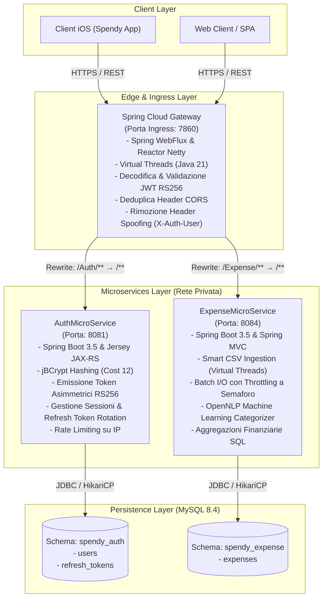
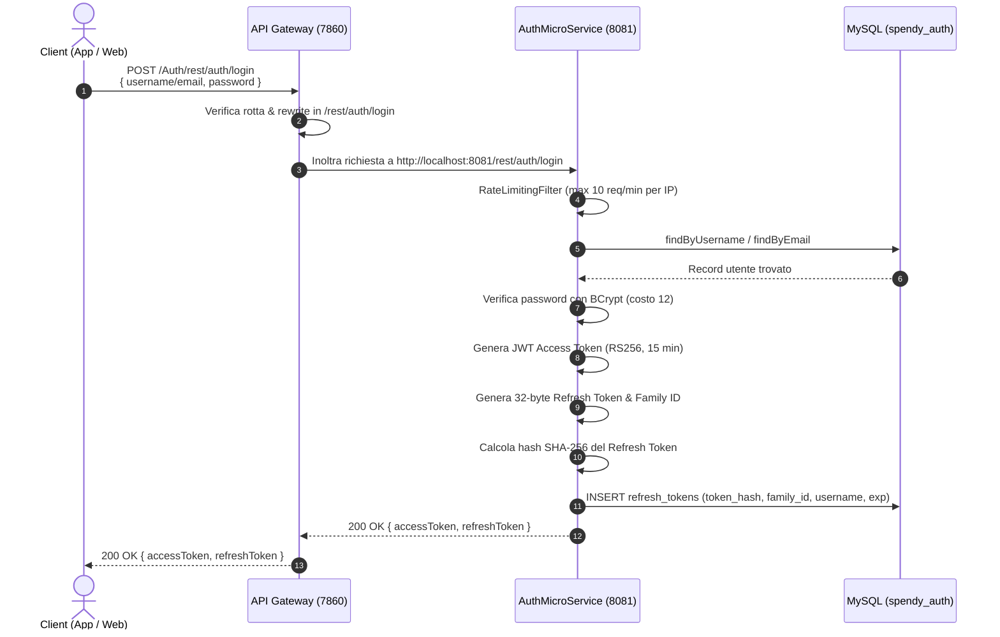
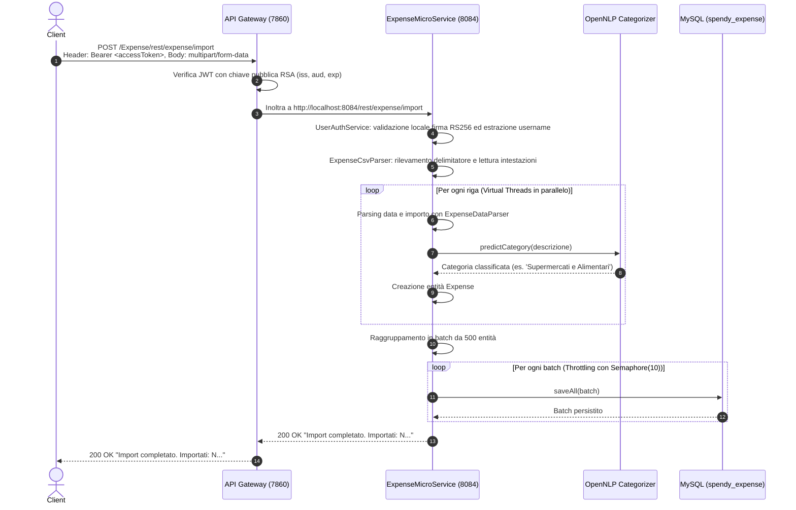

# Architettura di SpendyApp

Documentazione tecnica e architetturale del backend di **SpendyApp**, piattaforma distribuita a microservizi per la gestione finanziaria personale, il monitoraggio delle spese, l'importazione di estratti conto bancari e la categorizzazione intelligente tramite Machine Learning.

---

## 1. Stile Architetturale

SpendyApp adotta un'architettura **Cloud-Native a Microservizi**, strutturata con un pattern **API Gateway / Reverse Proxy Reattivo** che espone un punto di ingresso unico verso i client esterni (applicazioni mobili iOS, client Web) e maschera la topologia interna dei servizi applicativi e dei database relazionali.

---

## 2. Componenti e Moduli del Sistema

Il repository è strutturato come un progetto multi-modulo Apache Maven coordinato dal [pom.xml](file:///Users/gius03/Progetti/SpendyProject/SpendyApp/pom.xml) radice. I moduli applicativi sono tre:

### 2.1. API Gateway (`Gateway/`)
- **Ruolo**: Ingress reverse proxy reattivo e punto di terminazione perimetrale.
- **Classe di avvio**: [GatewayApplication.java](file:///Users/gius03/Progetti/SpendyProject/SpendyApp/Gateway/src/main/java/com/spendy/gateway/GatewayApplication.java)
- **Configurazione di sicurezza**: [SecurityConfig.java](file:///Users/gius03/Progetti/SpendyProject/SpendyApp/Gateway/src/main/java/com/spendy/gateway/JWT/SecurityConfig.java)
- **Tecnologie**: Spring Cloud Gateway Server WebFlux, Reactor Netty, Spring Security Reactive OAuth2 Resource Server.
- **Porta predefinita**: `7860` (ambiente produzione / Hugging Face Spaces e sviluppo locale; rimappabile sull'host tramite `GATEWAY_PORT`).
- **Responsabilità**:
  1. *Routing dinamico e path rewrite*: Reindirizza le richieste `/Auth/**` verso `AuthMicroService` (riscrivendo in `/${segment}`) e `/Expense/**` verso `ExpenseMicroService` (riscrivendo in `/${segment}`).
  2. *Autenticazione perimetrale OAuth2/JWT*: Valida localmente i token JWT Bearer in ingresso verificando crittograficamente la firma RSA (RS256) tramite chiave pubblica o endpoint JWKS RFC 7517.
  3. *Policy CORS globale*: Centralizza la gestione dei domini autorizzati ed esegue la deduplica degli header `Access-Control-Allow-Origin` e `Access-Control-Allow-Credentials` tramite il filtro `DedupeResponseHeader`.
  4. *Sanificazione header*: Elimina preventivamente header non autorizzati o potenzialmente falsificati quali `X-Auth-User` e `X-User-Id` tramite filtri `RemoveRequestHeader`.
  5. *Aggregazione documentazione OpenAPI*: Espone all'endpoint `/swagger-ui.html` l'interfaccia Swagger aggregata che unifica i percorsi di Gateway, Auth Service ed Expense Service.

### 2.2. Auth Microservice (`AuthMicroService/`)
- **Ruolo**: Identity Provider, gestione credenziali, emissione e rotazione token crittografici.
- **Classe di avvio**: [AuthMicroServiceApplication.java](file:///Users/gius03/Progetti/SpendyProject/SpendyApp/AuthMicroService/src/main/java/com/spendy/auth/AuthMicroServiceApplication.java)
- **Controller principale**: [AuthController.java](file:///Users/gius03/Progetti/SpendyProject/SpendyApp/AuthMicroService/src/main/java/com/spendy/auth/Controller/AuthController.java)
- **Servizio applicativo**: [AuthService.java](file:///Users/gius03/Progetti/SpendyProject/SpendyApp/AuthMicroService/src/main/java/com/spendy/auth/Service/AuthService.java)
- **Gestore crittografico**: [JwtTokenService.java](file:///Users/gius03/Progetti/SpendyProject/SpendyApp/AuthMicroService/src/main/java/com/spendy/auth/Security/JwtTokenService.java)
- **Filtro di protezione anti-bruteforce**: [RateLimitingFilter.java](file:///Users/gius03/Progetti/SpendyProject/SpendyApp/AuthMicroService/src/main/java/com/spendy/auth/Security/RateLimitingFilter.java)
- **Tecnologie**: Spring Boot 3.5, Jersey 3.x JAX-RS, Spring Data JPA, Hibernate 6, Flyway, jBCrypt, Nimbus Jose+JWT.
- **Porta interna**: `8081`.
- **Responsabilità**:
  1. *Registrazione utenti*: Validazione formati email, policy lunghezza password (8-128 caratteri) e hashing con [BCryptPasswordEncoder](file:///Users/gius03/Progetti/SpendyProject/SpendyApp/AuthMicroService/src/main/java/com/spendy/auth/Config/SecurityConfig.java#L34-L36) a fattore costo 12.
  2. *Autenticazione & Mitigazione Timing Attack*: Login con username o email con verifica costante delle password tramite hash fittizio in caso di utente inesistente.
  3. *Emissione JWT RS256*: Generazione di access token firmati con chiave RSA privata a 2048 bit, con `kid`, `iss`, `aud`, `exp` (15 minuti).
  4. *Gestione avanzata sessioni & Refresh Token Rotation*: Rotazione con rilevamento del riutilizzo (token reuse detection via `family_id`), revoca a catena della sessione compromessa e salvataggio nel database unicamente dell'hash SHA-256 del token.
  5. *Esposizione JWKS*: Endpoint conforme a RFC 7517 `/rest/auth/jwks.json` contenente la chiave pubblica RSA attiva e storiche per consentire la rotazione senza disservizi.

### 2.3. Expense Microservice (`ExpenseMicroService/`)
- **Ruolo**: Gestione delle transazioni finanziarie personali, elaborazione massiva di estratti conto CSV, analisi aggregata e categorizzazione automatica basata su NLP.
- **Classe di avvio**: [ExpenseMicroServiceApplication.java](file:///Users/gius03/Progetti/SpendyProject/SpendyApp/ExpenseMicroService/src/main/java/com/spendyteam/expense/ExpenseMicroServiceApplication.java)
- **Controller principale**: [ExpenseController.java](file:///Users/gius03/Progetti/SpendyProject/SpendyApp/ExpenseMicroService/src/main/java/com/spendyteam/expense/Controller/ExpenseController.java)
- **Servizio applicativo**: [ExpenseService.java](file:///Users/gius03/Progetti/SpendyProject/SpendyApp/ExpenseMicroService/src/main/java/com/spendyteam/expense/Service/ExpenseService.java)
- **Parser CSV ad alte prestazioni**: [ExpenseCsvParser.java](file:///Users/gius03/Progetti/SpendyProject/SpendyApp/ExpenseMicroService/src/main/java/com/spendyteam/expense/Service/ExpenseCsvParser.java)
- **Persistenza batch controllata**: [ExpenseBatchWriter.java](file:///Users/gius03/Progetti/SpendyProject/SpendyApp/ExpenseMicroService/src/main/java/com/spendyteam/expense/Service/ExpenseBatchWriter.java)
- **Motore di categorizzazione**: [SmartCategorizerService.java](file:///Users/gius03/Progetti/SpendyProject/SpendyApp/ExpenseMicroService/src/main/java/com/spendyteam/expense/Service/SmartCategorizerService.java) e fallback deterministico [ExpenseClassifier.java](file:///Users/gius03/Progetti/SpendyProject/SpendyApp/ExpenseMicroService/src/main/java/com/spendyteam/expense/Utility/ExpenseClassifier.java)
- **Verifica crittografica identità**: [UserAuthService.java](file:///Users/gius03/Progetti/SpendyProject/SpendyApp/ExpenseMicroService/src/main/java/com/spendyteam/expense/Service/UserAuthService.java)
- **Tecnologie**: Spring Boot 3.5, Spring Data JPA, Hibernate 6, MySQL Connector, Flyway, Apache OpenNLP 2.3.0, OpenCSV 5.9, Nimbus Jose+JWT.
- **Porta interna**: `8084`.
- **Responsabilità**:
  1. *CRUD Spese*: Creazione singola, consultazione ordinata per data, aggiornamento puntuale, cancellazione singola e rimozione totale dello storico per l'utente autenticato.
  2. *Importazione Intelligente CSV*: Parsing parallelo delle righe tramite Virtual Threads di Java 21, auto-riconoscimento del delimitatore (virgola, punto e virgola, tabulatore) e mappatura automatica dei campi bancari (Revolut, N26, Intesa Sanpaolo, ecc.).
  3. *Batch Write Protetta da Semaforo*: Scrittura a lotti di 500 record gestita con `Semaphore(10)` per prevenire la saturazione del pool di connessioni HikariCP.
  4. *Classificazione a Doppio Stadio*: Classificazione testuale della descrizione spesa tramite modello Maximum Entropy OpenNLP (`expense-model.bin`), con fallback su dizionario euristico.
  5. *Aggregazioni Mensili a livello Database*: Query nativa SQL raggruppata per mese (`DATE_FORMAT`) che somma le uscite escludendo entrate e rimborsi senza caricare i dati in memoria applicativa.

---

## 3. Gestione dei Dati e Confini di Responsabilità

Il sistema adotta il pattern di separazione delle basi dati (Database-per-Service logico):

| Servizio | Database / Schema | Entità Gestite | Migrazioni Schema |
| :--- | :--- | :--- | :--- |
| **AuthMicroService** | `spendy_auth` | [User.java](file:///Users/gius03/Progetti/SpendyProject/SpendyApp/AuthMicroService/src/main/java/com/spendy/auth/Data/User.java), [RefreshToken.java](file:///Users/gius03/Progetti/SpendyProject/SpendyApp/AuthMicroService/src/main/java/com/spendy/auth/Data/RefreshToken.java) | Flyway `V1`, `V2`, `V3` |
| **ExpenseMicroService** | `spendy_expense` | [Expense.java](file:///Users/gius03/Progetti/SpendyProject/SpendyApp/ExpenseMicroService/src/main/java/com/spendyteam/expense/Data/Expense.java) | Flyway `V1` |

I confini sono rigorosamente isolati:
- `ExpenseMicroService` non accede mai alle tabelle `users` o `refresh_tokens`. L'identità dell'utente viene desunta estraendo e verificando crittograficamente il claim `sub` dal token JWT Bearer fornito nell'header HTTP `Authorization`.
- `AuthMicroService` non possiede alcuna visibilità o dipendenza verso i dati delle transazioni finanziarie.
- Ciascun microservizio dispone del proprio pool di connessioni HikariCP dedicato (dimensione massima 20 connessioni per servizio).

---

## 4. Flussi di Esecuzione Principali

### 4.1. Flusso di Autenticazione e Login

### 4.2. Flusso di Importazione Massiva CSV

---

## 5. Comunicazioni Sincrone e Asincrone

1. **Comunicazione Esterna (Client &rarr; Gateway)**:
   - Esclusivamente sincrona via HTTP/1.1 e HTTP/2 su protocollo REST con payload JSON e `multipart/form-data`.
2. **Comunicazione Interna (Gateway &rarr; Microservizi)**:
   - Sincrona tramite proxy reattivo non bloccante Netty. Il Gateway instrada direttamente la richiesta al socket HTTP del microservizio target.
3. **Elaborazione Asincrona e Concorrente (In-Process)**:
   - **Java 21 Virtual Threads**: Abilitati globalmente con `spring.threads.virtual.enabled=true` in tutti i moduli.
   - **Parsing parallelo**: [ExpenseCsvParser.java](file:///Users/gius03/Progetti/SpendyProject/SpendyApp/ExpenseMicroService/src/main/java/com/spendyteam/expense/Service/ExpenseCsvParser.java#L92) istanzia un `Executors.newVirtualThreadPerTaskExecutor()` per elaborare concorrentemente centinaia di righe CSV senza bloccare i thread del server.
   - **Throttling I/O**: [ExpenseBatchWriter.java](file:///Users/gius03/Progetti/SpendyProject/SpendyApp/ExpenseMicroService/src/main/java/com/spendyteam/expense/Service/ExpenseBatchWriter.java#L25) disciplina le scritture concorrenti su disco tramite un semaforo a 10 permessi per proteggere la coda di connessione HikariCP.

---

## 6. Limiti e Punti di Attenzione Architetturali

1. **Deployment All-in-One vs Distribuito**:
   - In ambienti come Hugging Face Spaces, l'intero ecosistema (Gateway, Auth, Expense) gira all'interno di un unico container Docker orchestrato tramite [entrypoint.sh](file:///Users/gius03/Progetti/SpendyProject/SpendyApp/deploy/huggingface/entrypoint.sh). Questa configurazione richiede allocazioni di memoria controllate via `JAVA_TOOL_OPTIONS` e `Xmx` per evitare errori OutOfMemory.
2. **Assenza di Message Broker esterno**:
   - Attualmente non vi è un broker di messaggi distribuito (Kafka o RabbitMQ). Le comunicazioni e le reazioni tra domini sono disaccoppiate via token crittografici stateless (Zero-Trust).
3. **Distribuzione Chiavi Crittografiche**:
   - In produzione, `JWT_PRIVATE_KEY` e `JWT_PUBLIC_KEY` devono essere fornite tramite variabili d'ambiente o secret montati. L'impiego di chiavi effimere viene esplicitamente bloccato all'avvio in modalità produzione (`JWT_ALLOW_EPHEMERAL_KEYS=false`).
4. **Dipendenze native OpenNLP**:
   - Il categorizzatore ML dipende dalla corretta disponibilità del file di risorse [expense-model.bin](file:///Users/gius03/Progetti/SpendyProject/SpendyApp/ExpenseMicroService/src/main/resources/expense-model.bin). Qualora il modello non sia presente, il sistema ripiega in modo trasparente sul categorizzatore a regole [ExpenseClassifier](file:///Users/gius03/Progetti/SpendyProject/SpendyApp/ExpenseMicroService/src/main/java/com/spendyteam/expense/Utility/ExpenseClassifier.java).
