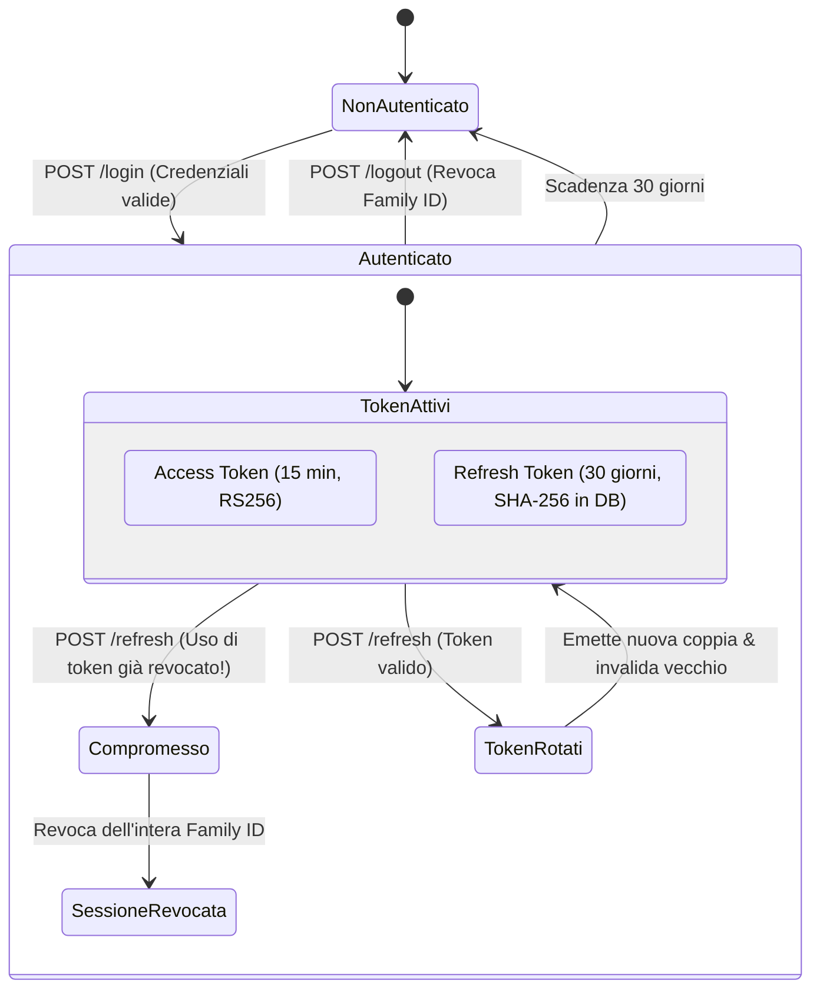
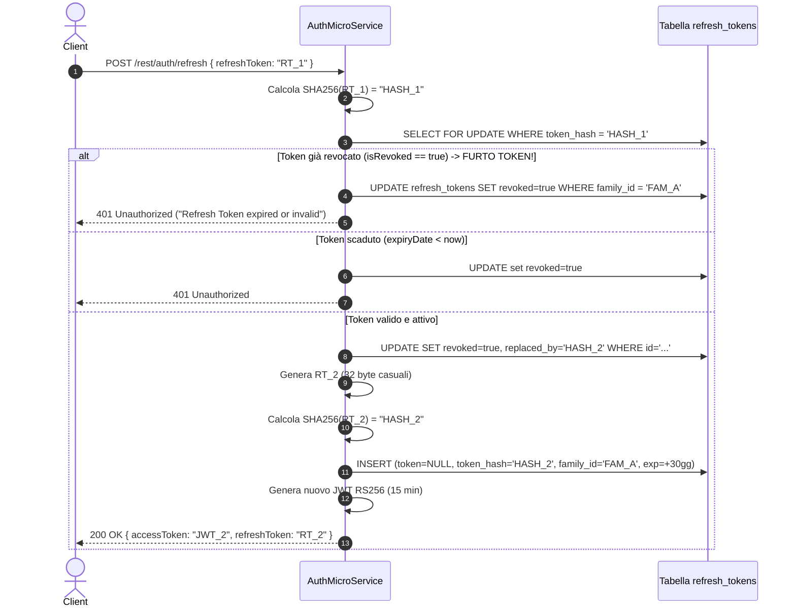

# Meccanismi di Autenticazione e Gestione Sessioni

Documentazione tecnica del sottosistema di identità, sicurezza crittografica e gestione delle sessioni implementato in **SpendyApp**.

---

## 1. Architettura di Sicurezza

SpendyApp adotta un modello di sicurezza distribuito **Zero-Trust** basato su:
1. **Crittografia Asimmetrica RSA (RS256)**: L'[AuthMicroService](../AuthMicroService/src/main/java/com/spendy/auth/Security/JwtTokenService.java) detiene la chiave privata RSA (a 2048 bit) ed è l'unica entità autorizzata a firmare i token. Tutti gli altri componenti ([Gateway](../Gateway/src/main/java/com/spendy/gateway/JWT/SecurityConfig.java) e [ExpenseMicroService](../ExpenseMicroService/src/main/java/com/spendyteam/expense/Service/UserAuthService.java)) dispongono unicamente della chiave pubblica RSA corrispondente per verificare localmente la firma dei token senza comunicazioni sincrone di validazione.
2. **Password Hashing con Salt**: Memorizzazione delle password utenti tramite [BCryptPasswordEncoder](../AuthMicroService/src/main/java/com/spendy/auth/Config/SecurityConfig.java#L34-L36) con fattore di costo 12 (`2^12` iterazioni).
3. **Mitigazione Timing Attack per Enumerazione Utenti**: Verifica della password in tempo costante anche per utenti non censiti.
4. **Refresh Token Rotation con Rilevamento Riutilizzo (RFC 6749 / OAuth 2.0 BCP)**: Gestione delle sessioni con rotazione automatica ad ogni utilizzo, isolamento per `family_id` e revoca immediata di tutti i token di una sessione in caso di tentativo di riutilizzo di un token già invalidato.
5. **Hashing Crittografico dei Refresh Token**: I token di rinnovo non risiedono mai in chiaro nel database: la colonna `token` è mantenuta `NULL` per i nuovi record e viene memorizzato unicamente l'hash crittografico **SHA-256** nella colonna `token_hash`.
6. **Rate Limiting Perimetrale**: Filtro [RateLimitingFilter](../AuthMicroService/src/main/java/com/spendy/auth/Security/RateLimitingFilter.java) con verifica rigorosa di `X-Forwarded-For` riservata ai soli proxy fidati.

---

## 2. Ciclo di Vita dei Token



| Tipologia | Durata di Validità | Algoritmo / Formato | Archiviazione Lato Server | Ruolo |
| :--- | :--- | :--- | :--- | :--- |
| **Access Token** | 15 minuti (`900.000` ms) | JWT firmato con **RS256** | Nessuna (Stateless, convalidato localmente tramite chiave pubblica) | Autorizzazione delle richieste alle risorse protette |
| **Refresh Token** | 30 giorni | 32 byte casuali (Base64 URL-safe) | Solo hash **SHA-256** nella tabella `refresh_tokens` | Rinnovo periodico dell'Access Token |

### 2.1. Anatomia del JWT Access Token
Un token generato da [JwtTokenService.java](../AuthMicroService/src/main/java/com/spendy/auth/Security/JwtTokenService.java#L201-L238) contiene:
- **Header**:
  ```json
  {
    "alg": "RS256",
    "kid": "spendy-auth-key-1",
    "typ": "JWT"
  }
  ```
- **Payload (Claims)**:
  - `sub`: Username dell'utente (es. `"mario_rossi"`).
  - `iss`: Issuer atteso (`"spendy-auth"`).
  - `aud`: Audience attesa (`"spendy-app"`).
  - `iat`: Timestamp di emissione.
  - `exp`: Timestamp di scadenza (ora corrente + 15 minuti).
  - `jti`: UUID univoco per il singolo token.
  - `roles`: Ruoli utente (predefinito: `["ROLE_USER"]`).

---

## 3. Gestione Credenziali e Login Anti-Enumeration

All'atto del login in [AuthService.java](../AuthMicroService/src/main/java/com/spendy/auth/Service/AuthService.java#L66-L84):
1. L'utente può presentarsi specificando indifferentemente `username` o `email`.
2. Se l'utente non viene trovato nel database, viene valutato un hash BCrypt fittizio precalcolato a costo 12 (`DUMMY_BCRYPT_HASH`):
   ```java
   private static final String DUMMY_BCRYPT_HASH = "$2a$12$e8wF2e9xP1R9K7m3Z1B5uO6A8c4E2G0I8K6M4O2Q0S8U6W4Y2a0c2";
   // In caso di utente non trovato:
   passwordEncoder.matches(password != null ? password : "", DUMMY_BCRYPT_HASH);
   ```
   Questa misura annulla qualsiasi discrepanza nei tempi di risposta del server, impedendo a un attaccante di identificare gli account validi misurando la latenza di rete (timing attack).
3. Le password vengono confrontate con `passwordEncoder.matches(password, user.getPassword())`.
4. Viene generata una nuova sessione identificata da un `familyId` univoco (`UUID.randomUUID().toString()`).

---

## 4. Dettaglio Implementativo della Refresh Token Rotation

Il protocollo implementato rispetta le raccomandazioni di sicurezza OAuth 2.0 BCP (Best Current Operational Practice) contro il furto di credenziali di sessione:



### Aspetti Chiave di Concorrenza e Persistenza:
- **Locking Pessimistico**: La lettura del token avviene tramite query `@Lock(PESSIMISTIC_WRITE)` (`findByTokenHashForUpdate`) per scongiurare race conditions causate da richieste di refresh simultanee inviate dalla stessa applicazione client.
- **Rilevamento del Riutilizzo**: Se il client invia un token il cui flag `revoked` è già `true`, significa che un attaccante (o un client disallineato) sta tentando di utilizzare un vecchio token già ruotato. Il sistema invoca immediatamente [IRefreshTokenRepository.revokeFamily](../AuthMicroService/src/main/java/com/spendy/auth/Repository/IRefreshTokenRepository.java#L40), invalidando tutti i token della famiglia `family_id` e costringendo il legittimo proprietario a riautenticarsi da capo.
- **Compatibilità Retroattiva**: Se nel database sono ancora presenti vecchi token memorizzati in chiaro (pre-migrazione `V3`), il sistema li legge, ne genera l'hash SHA-256 e azzera il campo `token` in chiaro alla prima rotazione.

---

## 5. Gestione delle Chiavi Crittografiche e Rotazione (Key Rotation)

La classe [JwtTokenService.java](../AuthMicroService/src/main/java/com/spendy/auth/Security/JwtTokenService.java) e la configurazione reattiva [SecurityConfig.java del Gateway](../Gateway/src/main/java/com/spendy/gateway/JWT/SecurityConfig.java) supportano nativamente la rotazione periodica delle chiavi crittografiche tramite l'header standard `kid` (Key ID).

### 5.1. Configurazione Chiavi e Variabili d'Ambiente
1. **Chiave Privata (Auth Microservice)**:
   - Stringa PEM diretta via variabile d'ambiente: `JWT_PRIVATE_KEY`
   - File PEM montato: `JWT_PRIVATE_KEY_LOCATION=file:/path/to/private_key.pem`
2. **Chiave Pubblica (Gateway & Expense Microservice)**:
   - Stringa PEM diretta via variabile d'ambiente: `JWT_PUBLIC_KEY`
   - File PEM montato: `JWT_PUBLIC_KEY_LOCATION=file:/path/to/public_key.pem`
   - Endpoint JWKS dinamico: `JWT_JWK_SET_URI=http://auth-service:8081/rest/auth/jwks.json`
3. **Identificativo Chiave Attiva**:
   - `JWT_ACTIVE_KEY_ID=spendy-auth-key-1`
4. **Chiavi Precedenti (Finestra di Transizione)**:
   - `JWT_PREVIOUS_PUBLIC_KEYS="spendy-auth-key-0=-----BEGIN PUBLIC KEY-----..."`
   Permette a Gateway ed Expense Microservice di continuare a validare i token emessi con la chiave precedente fino alla loro naturale scadenza (15 minuti), azzerando i disservizi durante la rotazione.

### 5.2. Blocco Rigoroso di Chiavi Effimere in Produzione
Il sistema rileva automaticamente se l'ambiente di esecuzione corrisponde alla produzione (tramite `SPRING_PROFILES_ACTIVE`, `ENVIRONMENT=production` o `SPACE_ID` su Hugging Face Spaces).
- Se l'ambiente è di **produzione** e le chiavi RSA non sono esplicitamente configurate, l'applicazione solleva immediatamente una `IllegalStateException` e interrompe l'avvio:
  ```text
  CRITICAL SECURITY ERROR: Ephemeral keys are strictly forbidden in production mode.
  Configure valid RSA keys (jwt.private-key or jwt.private-key-location) and set jwt.allow-ephemeral-keys=false.
  ```
- In ambiente di **sviluppo locale**, se le chiavi non sono fornite, il sistema genera una coppia di chiavi RSA a 2048 bit e la salva temporaneamente nella directory `keys/` solo se `jwt.allow-ephemeral-keys=true`.

---

## 6. Rate Limiting e Protezione Brute-Force

Il filtro [RateLimitingFilter](../AuthMicroService/src/main/java/com/spendy/auth/Security/RateLimitingFilter.java) protegge gli endpoint di autenticazione maggiormente esposti ad attacchi di forza bruta:

| Endpoint | Limite Richieste | Finestra Temporale | Azione al Superamento |
| :--- | :--- | :--- | :--- |
| `POST /rest/auth/login` | **10** richieste | 1 minuto (60.000 ms) | HTTP `429 Too Many Requests` + Header `Retry-After: <secondi>` |
| `POST /rest/auth/register` | **5** richieste | 1 minuto (60.000 ms) | HTTP `429 Too Many Requests` + Header `Retry-After: <secondi>` |
| `POST /rest/auth/refresh` | **30** richieste | 1 minuto (60.000 ms) | HTTP `429 Too Many Requests` + Header `Retry-After: <secondi>` |

### Validazione IP del Client:
Il filtro non si fida ciecamente dell'header `X-Forwarded-For`. L'header viene accettato **solo se** la connessione diretta proviene da un proxy esplicitamente configurato come fidato (`rate.limiting.trusted-proxies`, predefinito: `127.0.0.1, ::1, localhost`), prevenendo lo spoofing dell'indirizzo IP. Inoltre, la mappa in memoria dispone di un meccanismo di pulizia automatica (`evictExpiredEntriesIfOverCapacity`) per evitare memory leak in presenza di volumi elevati di traffico.
