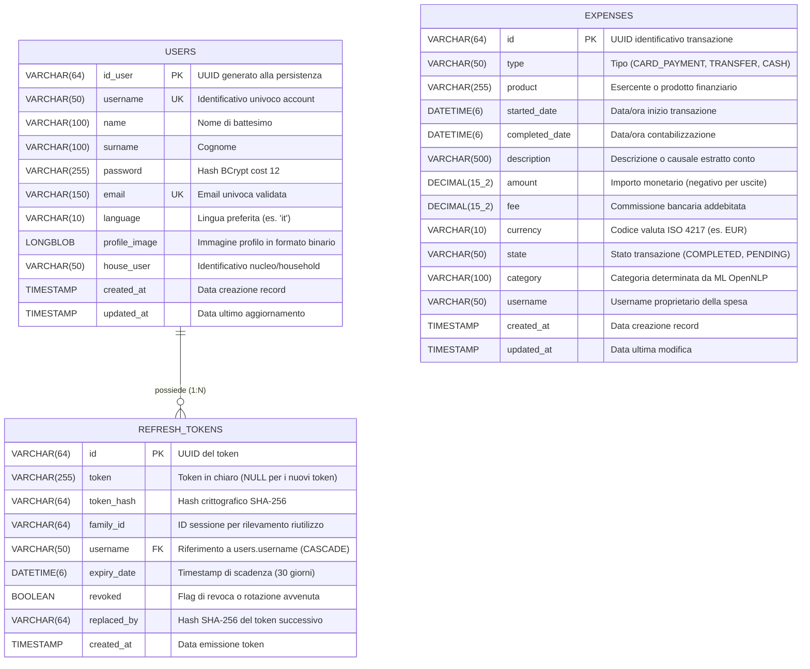

# Modello dei Dati e Persistenza Relazionale

Documentazione tecnica del modello dati, degli schemi relazionali MySQL 8.x, dei vincoli di integrità, delle strategie di indicizzazione e delle migrazioni Flyway in **SpendyApp**.

---

## 1. Diagramma Entità-Relazione (ER)

SpendyApp gestisce due schemi database distinti e indipendenti su MySQL: `spendy_auth` e `spendy_expense`.



---

## 2. Dettaglio Tabelle e Schemi Relazionali

### 2.1. Schema `spendy_auth`

#### Tabella `users`
Definita in [V1__create_auth_schema.sql](../AuthMicroService/src/main/resources/db/migration/V1__create_auth_schema.sql) e mappata dall'entità JPA [User.java](../AuthMicroService/src/main/java/com/spendy/auth/Data/User.java).

| Colonna | Tipo SQL | Vincoli | Descrizione |
| :--- | :--- | :--- | :--- |
| `id_user` | `VARCHAR(64)` | `PRIMARY KEY, NOT NULL` | UUID univoco immutabile, generato con `@PrePersist`. |
| `username` | `VARCHAR(50)` | `NOT NULL, UNIQUE` | Nome utente per il login (3-50 caratteri alfanumerici). |
| `name` | `VARCHAR(100)` | `NULL` | Nome dell'utente. |
| `password` | `VARCHAR(255)` | `NOT NULL` | Hash BCrypt della password a costo 12 con salt. |
| `surname` | `VARCHAR(100)` | `NULL` | Cognome dell'utente. |
| `email` | `VARCHAR(150)` | `NOT NULL, UNIQUE` | Email convalidata tramite regex formale. |
| `language` | `VARCHAR(10)` | `NULL` | Codice lingua dell'interfaccia (es. `"it"`). |
| `profile_image` | `LONGBLOB` | `NULL` | Dati binari dell'immagine del profilo utente. |
| `house_user` | `VARCHAR(50)` | `NULL` | Identificativo per associazione a gruppo/casa. |
| `created_at` | `TIMESTAMP` | `DEFAULT CURRENT_TIMESTAMP` | Data di registrazione dell'account. |
| `updated_at` | `TIMESTAMP` | `DEFAULT CURRENT_TIMESTAMP ON UPDATE CURRENT_TIMESTAMP` | Data dell'ultima modifica al profilo. |

**Indici**:
- `PRIMARY KEY (id_user)`
- `UNIQUE INDEX idx_users_username (username)`
- `UNIQUE INDEX idx_users_email (email)`
- `INDEX idx_users_house_user (house_user)`

---

#### Tabella `refresh_tokens`
Definita in [V1__create_auth_schema.sql](../AuthMicroService/src/main/resources/db/migration/V1__create_auth_schema.sql), estesa in [V2__security_refresh_tokens_hardening.sql](../AuthMicroService/src/main/resources/db/migration/V2__security_refresh_tokens_hardening.sql) e rilassata in [V3__security_refresh_tokens_null_token.sql](../AuthMicroService/src/main/resources/db/migration/V3__security_refresh_tokens_null_token.sql). Mappata da [RefreshToken.java](../AuthMicroService/src/main/java/com/spendy/auth/Data/RefreshToken.java).

| Colonna | Tipo SQL | Vincoli | Descrizione |
| :--- | :--- | :--- | :--- |
| `id` | `VARCHAR(64)` | `PRIMARY KEY, NOT NULL` | UUID univoco del token, generato alla persistenza. |
| `token` | `VARCHAR(255)` | `NULL` | Valore in chiaro mantenuto per retrocompatibilità. I nuovi token salvano `NULL` per sicurezza. |
| `token_hash` | `VARCHAR(64)` | `NULL` | Digest SHA-256 esadecimale (64 caratteri) del token casuale a 32 byte. |
| `family_id` | `VARCHAR(64)` | `NULL` | Identificativo comune per tutti i token appartenenti alla stessa sessione rotata. |
| `username` | `VARCHAR(50)` | `NOT NULL` | Riferimento all'utente proprietario della sessione. |
| `expiry_date` | `DATETIME(6)` | `NOT NULL` | Data e ora di scadenza (default: 30 giorni dall'emissione). |
| `revoked` | `BOOLEAN` | `NOT NULL, DEFAULT FALSE` | `true` se il token è stato ruotato o invalidato manualmente. |
| `replaced_by` | `VARCHAR(64)` | `NULL` | Hash SHA-256 del nuovo token emesso al momento della rotazione. |
| `created_at` | `TIMESTAMP` | `DEFAULT CURRENT_TIMESTAMP` | Data di creazione del token. |

**Chiavi Esterne e Indici**:
- `CONSTRAINT fk_refresh_tokens_user FOREIGN KEY (username) REFERENCES users (username) ON DELETE CASCADE`
- `INDEX idx_refresh_tokens_token (token)`
- `INDEX idx_refresh_tokens_token_hash (token_hash)`
- `INDEX idx_refresh_tokens_family_id (family_id)`
- `INDEX idx_refresh_tokens_username (username)`

---

### 2.2. Schema `spendy_expense`

#### Tabella `expenses`
Definita in [V1__create_expense_schema.sql](../ExpenseMicroService/src/main/resources/db/migration/V1__create_expense_schema.sql) e mappata dall'entità JPA [Expense.java](../ExpenseMicroService/src/main/java/com/spendyteam/expense/Data/Expense.java).

| Colonna | Tipo SQL | Vincoli | Descrizione |
| :--- | :--- | :--- | :--- |
| `id` | `VARCHAR(64)` | `PRIMARY KEY, NOT NULL` | UUID univoco assegnato a ciascuna transazione. |
| `type` | `VARCHAR(50)` | `NULL` | Tipo di operazione bancaria (`CARD_PAYMENT`, `TRANSFER`, `FEE`, ecc.). |
| `product` | `VARCHAR(255)` | `NULL` | Prodotto bancario o canale utilizzato (es. `"Current Account"`, `"Carta di Debito"`). |
| `started_date` | `DATETIME(6)` | `NULL` | Data e ora in cui la transazione è stata originata. |
| `completed_date` | `DATETIME(6)` | `NULL` | Data e ora di contabilizzazione contabile effettiva. |
| `description` | `VARCHAR(500)` | `NULL` | Testo descrittivo o causale della transazione (utilizzato dal motore ML). |
| `amount` | `DECIMAL(15, 2)`| `NOT NULL` | Importo monetario della spesa (segno negativo per addebiti, positivo per accrediti). |
| `fee` | `DECIMAL(15, 2)`| `DEFAULT 0.00` | Commissione applicata dall'istituto di pagamento. |
| `currency` | `VARCHAR(10)` | `NULL` | Codice ISO 4217 della valuta (es. `"EUR"`, `"USD"`). |
| `state` | `VARCHAR(50)` | `NULL` | Stato di regolamento (`"COMPLETED"`, `"PENDING"`, `"REVERTED"`). |
| `category` | `VARCHAR(100)` | `NULL` | Categoria assegnata dall'AI OpenNLP o dal dizionario di fallback. |
| `username` | `VARCHAR(50)` | `NOT NULL` | Username proprietario del record (chiave di partizionamento logico). |
| `created_at` | `TIMESTAMP` | `DEFAULT CURRENT_TIMESTAMP` | Data di inserimento del record nel database. |
| `updated_at` | `TIMESTAMP` | `DEFAULT CURRENT_TIMESTAMP ON UPDATE CURRENT_TIMESTAMP` | Data dell'ultima modifica del record. |

**Indici Ottimizzati per Query di Reportistica**:
- `PRIMARY KEY (id)`
- `INDEX idx_expenses_username (username)`: velocizza la ricerca di tutte le spese dell'utente e la cancellazione massiva.
- `INDEX idx_expenses_user_started (username, started_date)`: indice composto per le query di filtraggio per intervallo temporale (`getExpenseByDate`, `getExpenseByMonth`).
- `INDEX idx_expenses_user_completed (username, completed_date)`: indice composto per filtri sulla data di completamento.
- `INDEX idx_expenses_user_category (username, category)`: ottimizza le aggregazioni e i raggruppamenti per tipologia di spesa.

---

## 3. Strategie di Accesso ai Dati e Performance

### 3.1. Batch Inserts Ottimizzati con Hibernate
In [ExpenseMicroService/application.properties](../ExpenseMicroService/src/main/resources/application.properties#L22-L24):
```properties
spring.jpa.properties.hibernate.jdbc.batch_size=500
spring.jpa.properties.hibernate.order_inserts=true
spring.jpa.properties.hibernate.order_updates=true
```
Queste direttive impongono al driver JDBC di raggruppare le istruzioni SQL `INSERT` in lotti unificati da 500 righe per volta, riducendo drasticamente il numero di round-trip di rete verso il server MySQL durante l'importazione di estratti conto massivi.

### 3.2. Aggregazione Mensile Push-Down al Database
Nel repository [IExpenseRepository.java](../ExpenseMicroService/src/main/java/com/spendyteam/expense/Repository/IExpenseRepository.java#L60-L76), il calcolo dei totali per anno e mese non carica in memoria le singole entità ma esegue l'aggregazione nativamente all'interno dell'engine MySQL:

```sql
SELECT DATE_FORMAT(e.started_date, '%Y-%m') AS monthKey,
       SUM(e.amount) AS totalAmount
FROM expenses e
WHERE e.username = :username
  AND e.started_date IS NOT NULL 
  AND e.completed_date IS NOT NULL
  AND e.started_date >= :start 
  AND e.completed_date <= :end
  AND e.started_date < :end 
  AND e.completed_date > :start
  AND e.amount IS NOT NULL
  AND e.amount <= 0
GROUP BY DATE_FORMAT(e.started_date, '%Y-%m')
ORDER BY monthKey ASC
```
I risultati sono mappati direttamente nell'interfaccia di proiezione Spring Data [MonthlyExpenseTotal.java](../ExpenseMicroService/src/main/java/com/spendyteam/expense/DTO/MonthlyExpenseTotal.java).

---

## 4. Cronologia e Compatibilità delle Migrazioni Flyway

Tutte le modifiche allo schema DDL sono versionate ed eseguite automaticamente all'avvio dei microservizi con `spring.flyway.enabled=true`:

1. **`AuthMicroService/src/main/resources/db/migration/`**:
   - `V1__create_auth_schema.sql`: Creazione iniziale delle tabelle `users` e `refresh_tokens`, con indici e vincolo di foreign key `ON DELETE CASCADE`.
   - `V2__security_refresh_tokens_hardening.sql`: Aggiunta delle colonne `token_hash`, `family_id`, `revoked` e `replaced_by` con indici dedicati per supportare la rotazione e il rilevamento del furto del token.
   - `V3__security_refresh_tokens_null_token.sql`: Modifica della colonna `token` da `NOT NULL` a `NULL` per permettere l'archiviazione esclusiva dell'hash SHA-256.
2. **`ExpenseMicroService/src/main/resources/db/migration/`**:
   - `V1__create_expense_schema.sql`: Creazione della tabella `expenses` con indici compositi per username, date e categorie.
