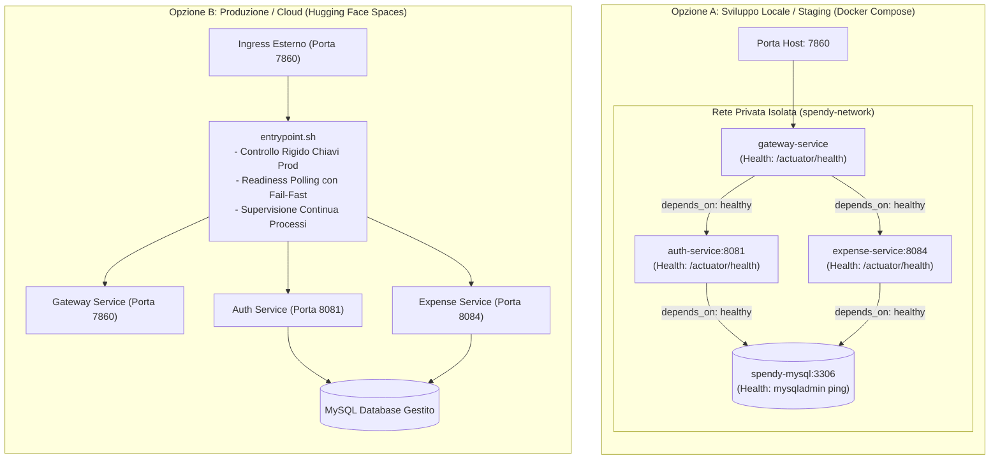

# Guida al Deployment e Pipeline CI/CD

Questa guida descrive le modalità di deployment di **SpendyApp**, l'architettura della pipeline CI/CD con GitHub Actions, la configurazione per **Hugging Face Spaces** e le procedure di rollback.

---

## 1. Architettura dei Deployment

SpendyApp supporta due modalità operative:



---

## 2. Pipeline CI/CD (GitHub Actions)

La pipeline è rigorosamente separata in due workflow distinti:

```
Push / Pull Request (main)
           │
           ▼
┌─────────────────────────────────────┐
│ 1. CI - Build, Test and Verify      │ (.github/workflows/ci.yml)
│    - JDK 21 (Temurin) & Maven Cache │
│    - mvn clean verify               │
│    - Upload Surefire XML Reports    │
│    - Upload JaCoCo Coverage HTML    │
└──────────────────┬──────────────────┘
                   │
                   ▼ (Esclusivamente se CI = SUCCESS su branch main)
┌─────────────────────────────────────┐
│ 2. CD - Deploy Hugging Face Spaces  │ (.github/workflows/deploy-huggingface.yml)
│    - Validazione Secrets Obbligatori│
│    - Verifica Integrità             │
│    - Git Push sicuro verso lo Space │
└─────────────────────────────────────┘
```

### 2.1. Workflow di Continuous Integration (`ci.yml`)
- **Trigger**: `push` su `main`, `pull_request` su `main`, `workflow_dispatch`.
- **Esecuzione**: Compila tutti i moduli con il reactor Maven, esegue l'intera suite di oltre 170 test automatizzati, genera i report Surefire e verifica la soglia di copertura minima JaCoCo.
- **Artefatti Pubblicati**:
  - `surefire-test-reports`: caricato anche in caso di fallimento (`if: always()`) per diagnosi immediata.
  - `jacoco-coverage-reports`: report dettagliato della copertura per modulo.

### 2.2. Workflow di Continuous Deployment (`deploy-huggingface.yml`)
- **Trigger**: `workflow_run` (attivato automaticamente al completamento con successo della CI su `main`) e `workflow_dispatch` (per deploy manuale controllato).
- **Controllo Sicurezza**:
  - Verifica la presenza dei segreti (`HF_TOKEN`, `HF_USERNAME`, `SPACE_NAME`).
  - Maschera i token nei log tramite `::add-mask::`.
  - Non esegue deploy su pull request non fidate o rami secondari.
- **Destinazione**: Sincronizza il commit verificato sul repository Git dello Space Hugging Face.

### 2.3. Segreti GitHub Richiesti
Nelle impostazioni del repository GitHub (**Settings &rarr; Secrets and variables &rarr; Actions**):
- `HF_TOKEN`: Personal Access Token di Hugging Face con permessi di scrittura (**Write**).
- `HF_USERNAME`: Nome utente o organizzazione Hugging Face (es. `Khondor03`).
- `SPACE_NAME`: Nome dello Space target (es. `Spendy`).

---

## 3. Deployment Locale (Docker Compose)

Per avviare l'ambiente multi-container con database locale:

```bash
# Avvio automatico con controllo dipendenze e healthcheck
./scripts/dev-up.sh

# Verifica con smoke test
./scripts/smoke-test.sh

# Arresto senza cancellare i dati del database
./scripts/dev-down.sh
```

---

## 4. Deployment All-in-One (Hugging Face Spaces)

Il target predefinito del [Dockerfile](file:///Users/gius03/Progetti/SpendyProject/SpendyApp/Dockerfile) è `all-in-one`:
1. Utilizza l'immagine leggera `eclipse-temurin:21-jre-alpine`.
2. Esegue come utente non privilegiato `user` (UID 1000).
3. Espone la porta standard `7860`.
4. Utilizza lo script [`deploy/huggingface/entrypoint.sh`](file:///Users/gius03/Progetti/SpendyProject/SpendyApp/deploy/huggingface/entrypoint.sh) che supervisiona tutti e tre i microservizi JVM. Se uno qualsiasi dei processi interni termina o non supera la readiness probe, il container abortisce immediatamente.

Per ulteriori dettagli su Hugging Face Spaces, consultare [`deploy/huggingface/README.md`](file:///Users/gius03/Progetti/SpendyProject/SpendyApp/deploy/huggingface/README.md).

---

## 5. Procedura di Rollback

In caso di malfunzionamento dopo un deployment su Hugging Face Spaces:

### 5.1. Rollback tramite Git (Consigliato)
1. Identificare l'ultimo commit stabile:
   ```bash
   git log --oneline -n 5
   ```
2. Creare un commit di revert sul branch `main`:
   ```bash
   git revert HEAD
   git push origin main
   ```
3. La pipeline CI rieseguirà i test e attiverà automaticamente il deployment della versione corretta su Hugging Face.

### 5.2. Rollback Manuale di Emergenza
Se necessario forzare immediatamente una versione precedente su Hugging Face senza passare da un nuovo commit:
1. Andare sulla scheda **Actions** di GitHub.
2. Selezionare il workflow **CD - Deploy to Hugging Face Spaces**.
3. Cliccare su **Run workflow**, inserire il commit desiderato e abilitare se necessario il flag `force_push`.
