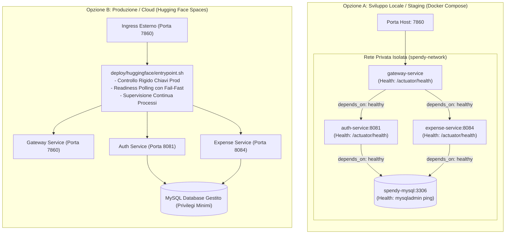

# Guida al Deployment e Pipeline CI/CD

Questa guida descrive le modalità di deployment di **SpendyApp**, l'architettura della pipeline CI/CD con GitHub Actions, la gestione sicura della sincronizzazione Git, la verifica post-deployment a due livelli, la configurazione per **Hugging Face Spaces** e le procedure di rollback.

---

## 1. Architettura dei Deployment

SpendyApp supporta due modalità operative:



---

## 2. Pipeline CI/CD (GitHub Actions)

La pipeline è rigorosamente disaccoppiata in due workflow distinti, con separazione esplicita tra verifica statica/test (CI), sincronizzazione codice (CD Deploy) e controllo runtime post-deployment:

```
Push / Pull Request (main)
           │
           ▼
┌─────────────────────────────────────┐
│ 1. CI - Build, Test and Verify      │ (.github/workflows/ci.yml)
│    - JDK 21 (Temurin) & Maven Cache │
│    - mvn clean verify               │
│    - Upload Surefire XML Reports    │
│    - Upload JaCoCo Coverage HTML    │
└──────────────────┬──────────────────┘
                   │
                   ▼ (Esclusivamente se CI = SUCCESS sul branch 'main')
┌─────────────────────────────────────┐
│ 2. CD - Deploy Hugging Face Spaces  │ (.github/workflows/deploy-huggingface.yml)
│    ┌─────────────────────────────┐  │
│    │ Job: deploy                 │  │
│    │ - Verifica Secrets/Vars     │  │
│    │ - Analisi Divergenza Git    │  │
│    │ - Push sicuro (No Force)    │  │
│    └──────────────┬──────────────┘  │
│                   │                 │
│                   ▼                 │
│    ┌─────────────────────────────┐  │
│    │ Job: verify-deployment      │  │
│    │ - Polling API HF Spaces     │  │
│    │   (Attesa stage: RUNNING)   │  │
│    │ - Healthcheck /actuator     │  │
│    │   (Attesa HTTP 200 UP)      │  │
│    │ - Routing downstream Auth   │  │
│    └─────────────────────────────┘  │
└─────────────────────────────────────┘
```

### 2.1. Workflow di Continuous Integration (`ci.yml`)
- **Trigger**: `push` su `main`, `pull_request` su `main`, `workflow_dispatch`.
- **Esecuzione**: Compila tutti i moduli con il reactor Maven, esegue l'intera suite di oltre 170 test automatizzati, genera i report Surefire e verifica la soglia di copertura minima JaCoCo.
- **Artefatti Pubblicati**:
  - `surefire-test-reports`: caricato anche in caso di fallimento (`if: always()`) per diagnosi immediata.
  - `jacoco-coverage-reports`: report dettagliato della copertura per modulo.

---

### 2.2. Workflow di Continuous Deployment (`deploy-huggingface.yml`)

Il workflow CD si articola in due job sequenziali indipendenti per garantire che il push del codice non venga scambiato per prova di salute applicativa:

#### Job 1: `deploy` (Sincronizzazione Codice e Protezione Divergenza)
- **Eliminazione del fallback automatico a force-push**: La pipeline non esegue mai `git push --force` o `git reset --hard` in automatico.
- **Analisi delle relazioni Git**:
  1. **Primo Push**: Se il branch `space/main` non esiste, viene eseguito il push iniziale.
  2. **Up-to-Date (`LOCAL == REMOTE`)**: Se il commit locale coincide con quello remoto, il push viene saltato senza errori.
  3. **Fast-Forward (`REMOTE == BASE`)**: Se la storia locale è un'evoluzione lineare di quella remota, viene eseguito un push standard.
  4. **Remote Ahead (`LOCAL == BASE`)**: Se il repository Hugging Face contiene commit più recenti non presenti nel branch locale, il deployment **fallisce immediatamente con errore esplicito**.
  5. **Divergenza (`LOCAL != BASE && REMOTE != BASE`)**: Se le storie hanno divergito (ad es. modifiche manuali ai metadati README dello Space o commit non sincronizzati), il deployment **si interrompe immediatamente con errore bloccante e istruzioni diagnostiche**, senza sovrascrivere i commit remoti.
- **Forzatura controllata**: L'opzione `--force` è consentita **esclusivamente su autorizzazione esplicita dell'operatore** avviando manualmente il workflow via `workflow_dispatch` con il parametro `force_push: true`.
- **Protezione credenziali**: Il token `HF_TOKEN` viene mascherato con `::add-mask::` e configurato tramite header HTTP Git (`http.https://huggingface.co/.extraheader`), evitando di esporre credenziali negli URL dei remote.

#### Job 2: `verify-deployment` (Verifica Post-Deployment a Due Livelli)
Il successo del push Git attesta unicamente che i file sorgente sono stati trasferiti. Per validare l'effettiva erogazione del servizio:

1. **Livello 1: Stato dell'Infrastruttura (API Hugging Face Spaces)**:
   - Interroga periodicamente l'endpoint API:
     `GET https://huggingface.co/api/spaces/${HF_USERNAME}/${SPACE_NAME}`
   - Monitora la proprietà `runtime.stage`:
     - Stati transitori (`BUILDING`, `APP_STARTING`, `RUNNING_BUILDING`): polling periodico fino a 10 minuti.
     - Stati terminali di errore (`BUILD_ERROR`, `RUNTIME_ERROR`, `CONFIG_ERROR`): fail-fast immediato con link diretto ai log dello Space.
     - Stato target: `RUNNING` (container compilato e avviato).
2. **Livello 2: Disponibilità Applicativa (Spring Boot Actuator)**:
   - Ricava l'hostname pubblico dello Space (dal payload API o dal pattern `https://<user>-<space>.hf.space`).
   - Esegue il polling dell'endpoint di readiness pubblico `/actuator/health`:
     - Gestisce in modo controllato codici HTTP transitori di warm-up (502, 503, 504, 404, connessioni rifiutate).
     - Valida la ricezione di `HTTP 200` con payload `{"status":"UP"}`.
   - Verifica l'instradamento downstream verso AuthMicroService:
     - `GET /Auth/rest/auth/health` &rarr; `HTTP 200`.
3. **Quattro Stati Distinti della Pipeline**:
   - `[✓] 1. CI completata` (Maven build e test passati)
   - `[✓] 2. Push completato` (Sincronizzazione Git sicura completata)
   - `[✓] 3. Space avviato` (Hugging Face runtime stage: RUNNING)
   - `[✓] 4. Applicazione pronta` (Gateway Actuator Health: 200 UP)

---

### 2.3. Segreti e Variabili GitHub Actions
Configurare in **Settings &rarr; Secrets and variables &rarr; Actions**:

| Nome | Tipo | Descrizione |
| :--- | :--- | :--- |
| `HF_TOKEN` | **Secret** (obbligatorio) | Personal Access Token di Hugging Face con permessi di scrittura (**Write**). |
| `HF_USERNAME` | Secret o Variable | Nome utente o organizzazione Hugging Face (es. `Giusk10`). |
| `SPACE_NAME` | Secret o Variable | Nome dello Space target (es. `SpendyApp`). |

---

## 3. Deployment Locale (Docker Compose)

Per avviare l'ambiente multi-container con database locale:

```bash
# Avvio sicuro con validazione demone Docker, .env e healthcheck di tutti i servizi
./scripts/dev-up.sh

# Verifica con smoke test end-to-end
./scripts/smoke-test.sh

# Arresto preservando il volume persistente dei dati (NO -v)
./scripts/dev-down.sh
```

### 3.1. Comportamento di `scripts/dev-up.sh`
- **Controllo preventivo**: Verifica che Docker e il plugin Docker Compose siano installati e che il demone dockerd sia attivo. Se il demone non risponde, termina con exit code `1`.
- **Gestione sicura di `.env`**: Se `.env` non esiste, non tenta sovrascritture automatiche; guida l'utente a crearlo da `.env.example` ricordando che i default sono adatti solo allo sviluppo locale.
- **Healthcheck su tutti i servizi essenziali**: Attende che `mysql`, `auth-service`, `expense-service` e `gateway-service` raggiungano contestualmente lo stato `healthy`.
- **Gestione del timeout e codici di uscita**: Se un servizio termina anomalo (`exited`) o non diventa healthy entro il timeout finito e configurabile (`DEV_UP_TIMEOUT`, default 90s), lo script termina con exit code `1`, indica il nome esatto del servizio guasto e le istruzioni diagnostiche (`docker compose logs <servizio>`).

---

## 4. Diagnosi di Errori Post-Deployment

In caso di fallimento della fase `verify-deployment`:

1. **Space in stato `BUILD_ERROR`**:
   - Il build del Dockerfile su Hugging Face è fallito (ad es. problemi di dipendenze alpine o compilazione).
   - Verificare i log di compilazione su: `https://huggingface.co/spaces/<user>/<space>`.
2. **Space in stato `RUNTIME_ERROR`**:
   - Il container è terminato prematuramente durante l'avvio di `entrypoint.sh`.
   - Cause tipiche: assenza delle chiavi RSA obbligatorie in produzione (`JWT_PRIVATE_KEY` o `JWT_PUBLIC_KEY`), database MySQL remoto irraggiungibile o credenziali DB errate.
3. **Timeout su `/actuator/health` (HTTP 503 / 502 persistente)**:
   - Il container è running ma Spring Cloud Gateway non riesce a comunicare con i microservizi interni o l'ingress Hugging Face non ha ancora agganciato la porta 7860.
   - Consultare la scheda *Logs* dello Space per visionare i log stdout/stderr emessi da `entrypoint.sh`.

---

## 5. Procedura di Rollback

### 5.1. Rollback tramite Git (Consigliato)
1. Identificare l'ultimo commit stabile:
   ```bash
   git log --oneline -n 5
   ```
2. Creare un commit di revert sul branch `main`:
   ```bash
   git revert HEAD
   git push origin main
   ```
3. La pipeline CI rieseguirà i test e attiverà automaticamente il deployment della versione corretta su Hugging Face.

### 5.2. Rollback Manuale di Emergenza
Se è necessario forzare una sincronizzazione con riscrittura della storia verso Hugging Face:
1. Accedere alla scheda **Actions** di GitHub.
2. Selezionare il workflow **CD - Deploy to Hugging Face Spaces**.
3. Cliccare su **Run workflow**, selezionare il branch desiderato e impostare `force_push: true`.
