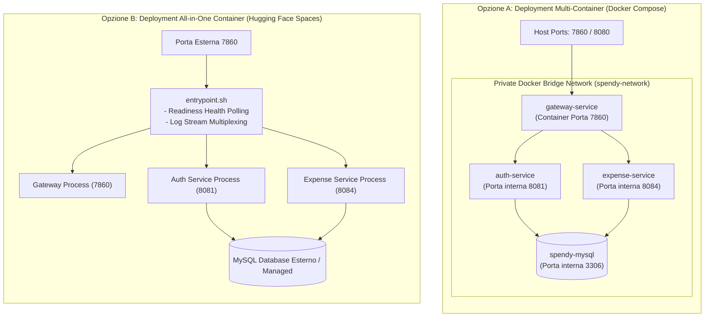
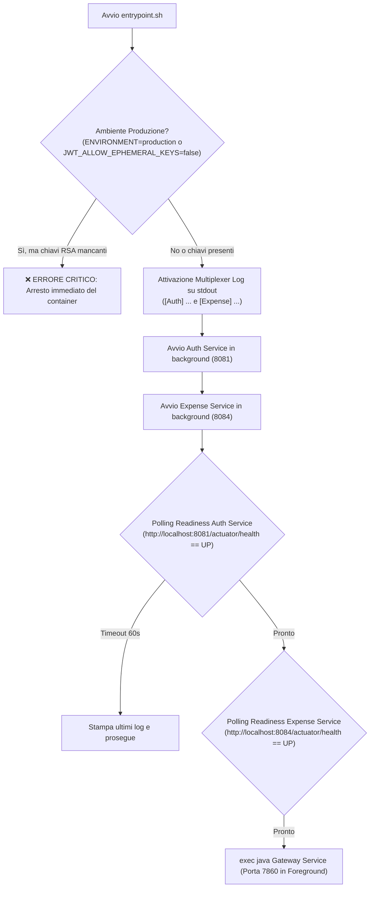

# Guida al Deployment e Gestione Operativa

Documentazione tecnica delle procedure di distribuzione, configurazione degli ambienti, orchestrazione dei container Docker, sicurezza dei container e monitoraggio operativo di **SpendyApp**.

---

## 1. Architettura degli Ambienti di Deployment

SpendyApp supporta due modalità primarie di deployment per soddisfare contesti operativi differenti:



---

## 2. Tabella Completa delle Variabili d'Ambiente

Tutti i microservizi possono essere configurati tramite file `.env` posizionato nella root o mediante variabili d'ambiente di sistema (es. Secret Docker o Kubernetes):

| Variabile | Valore Predefinito | Descrizione e Note di Sicurezza |
| :--- | :--- | :--- |
| `MYSQL_HOST` | `localhost` (o `mysql`) | Hostname del database MySQL (in Compose: `mysql`). |
| `MYSQL_PORT` | `3306` | Porta del servizio MySQL. |
| `MYSQL_USER` | `spendy` (o `root`) | Nome utente database con privilegi su `spendy_auth` e `spendy_expense`. |
| `MYSQL_PASSWORD` | `spendy_user_secret...` | Password dell'utente database (da modificare in produzione). |
| `MYSQL_ROOT_PASSWORD` | `spendy_root_secret...` | Password dell'utente root per l'inizializzazione del container MySQL. |
| `MYSQL_DATABASE_AUTH` | `spendy_auth` | Nome dello schema relazionale per l'Auth Microservice. |
| `MYSQL_DATABASE_EXPENSE` | `spendy_expense` | Nome dello schema relazionale per l'Expense Microservice. |
| `JWT_ISSUER` | `spendy-auth` | Claim `iss` atteso e validato nei token JWT. |
| `JWT_AUDIENCE` | `spendy-app` | Claim `aud` atteso e validato nei token JWT. |
| `JWT_EXPIRATION` | `900000` | Durata dell'Access Token in millisecondi (`15 minuti`). |
| `JWT_PRIVATE_KEY` | *(vuoto)* | Chiave privata RSA in formato PEM stringa (obbligatoria in prod per Auth). |
| `JWT_PUBLIC_KEY` | *(vuoto)* | Chiave pubblica RSA in formato PEM stringa (obbligatoria in prod per Gateway ed Expense). |
| `JWT_PRIVATE_KEY_LOCATION` | *(vuoto)* | Percorso URI risorsa della chiave privata (es. `file:/run/secrets/privkey.pem`). |
| `JWT_PUBLIC_KEY_LOCATION` | *(vuoto)* | Percorso URI risorsa della chiave pubblica (es. `file:/run/secrets/pubkey.pem`). |
| `JWT_ACTIVE_KEY_ID` | `spendy-auth-key-1` | Identificativo attivo (`kid`) inserito nell'header JWT. |
| `JWT_PREVIOUS_PUBLIC_KEYS` | *(vuoto)* | Chiavi pubbliche precedenti per garantire la rotazione delle chiavi senza disservizi. |
| `JWT_JWK_SET_URI` | *(vuoto)* | URL dell'endpoint JWKS per la risoluzione dinamica delle chiavi nel Gateway. |
| `JWT_ALLOW_EPHEMERAL_KEYS` | `false` | Se `true`, consente la generazione temporanea di chiavi RSA in dev. **Deve essere `false` in produzione!** |
| `CORS_ALLOWED_ORIGINS` | Elenco localhost/HF | Domini client abilitati per le richieste CORS (separati da virgola). |
| `RATE_LIMITING_ENABLED` | `true` | Abilita la protezione da brute-force su login, registrazione e refresh token. |
| `AUTH_SERVICE_URI` | `http://localhost:8081` | URL interno per instradare le richieste dal Gateway all'Auth Service. |
| `EXPENSE_SERVICE_URI` | `http://localhost:8084` | URL interno per instradare le richieste dal Gateway all'Expense Service. |
| `JAVA_TOOL_OPTIONS` | `-Xms128m -Xmx256m` | Parametri JVM per il controllo della memoria heap allocata per processo. |

---

## 3. Modalità di Deployment

### 3.1. Deployment con Docker Compose (Ambiente Distribuito)
Il file [docker-compose.yml](file:///Users/gius03/Progetti/SpendyProject/SpendyApp/docker-compose.yml) orchestra 4 container isolati sulla rete interna `spendy-network`:
- `spendy-mysql`: MySQL 8.4 con volume persistente `mysql-data` e inizializzazione automatica via `init-db.sql`.
- `auth-service`: build del target `auth-service` dal Dockerfile, porta 8081 isolata.
- `expense-service`: build del target `expense-service` dal Dockerfile, porta 8084 isolata.
- `gateway-service`: build del target `gateway-service`, espone verso l'esterno le porte `7860` e `8080`.

#### Avvio e Monitoraggio:
```bash
# Avviare tutti i servizi in background con ricompilazione delle immagini
docker compose up --build -d

# Verificare lo stato di salute dei servizi (healthcheck)
docker compose ps

# Visualizzare i log del gateway in streaming
docker compose logs -f gateway-service
```

#### Isolamento Perimetrale di Rete:
Nel file `docker-compose.yml`, i container `spendy-mysql`, `auth-service` e `expense-service` utilizzano la direttiva `expose` anziché `ports`. Di conseguenza:
- Le porte del database (`3306`) e dei microservizi interni (`8081`, `8084`) **non sono mappate sull'host fisico**, ma rimangono raggiungibili unicamente all'interno della rete Docker privata `spendy-network`.
- Qualsiasi client esterno è obbligato a transitare attraverso il Gateway sulla porta `7860`.

---

### 3.2. Deployment All-in-One (Hugging Face Spaces / PaaS)
Il target predefinito `all-in-one` di [Dockerfile](file:///Users/gius03/Progetti/SpendyProject/SpendyApp/Dockerfile#L51-L75) impacchetta i tre file JAR compilati (`auth-service.jar`, `expense-service.jar`, `gateway-service.jar`) all'interno di una singola immagine basata su `eclipse-temurin:21-jdk-alpine`.

#### Esecuzione Locale dell'Immagine All-in-One:
```bash
# 1. Compilare l'immagine completa
docker build -t spendy-all-in-one:latest .

# 2. Avviare il container passando il file delle variabili d'ambiente
docker run -d \
  --name spendy-instance \
  -p 7860:7860 \
  --env-file .env \
  spendy-all-in-one:latest
```

---

## 4. Meccanismo di Avvio e Readiness Polling (`entrypoint.sh`)

Lo script [entrypoint.sh](file:///Users/gius03/Progetti/SpendyProject/SpendyApp/entrypoint.sh) garantisce l'ordinamento deterministico dell'avvio:



### Caratteristiche Salienti dello Script:
1. **Prevenzione Fallimenti Silenti**: Se l'ambiente è di produzione e non sono state fornite chiavi RSA valide, il container termina immediatamente con codice di uscita `1`, impedendo che il servizio entri in esecuzione in uno stato insicuro.
2. **Log Stream Multiplexing**: I log di Auth ed Expense vengono scritti nei file `/app/auth.log` e `/app/expense.log` e contemporaneamente inoltrati allo standard output con prefisso `[Auth]` ed `[Expense]`. In questo modo la console di Hugging Face Spaces mostra in tempo reale tutti i messaggi dei microservizi.
3. **Controllo con Wget**: Verifica attivamente per un massimo di 60 secondi che gli endpoint `/actuator/health` rispondano `{"status":"UP"}` prima di avviare il Gateway.

---

## 5. Sicurezza dei Container e Best Practices

1. **Esecuzione Rootless**:
   Nel [Dockerfile](file:///Users/gius03/Progetti/SpendyProject/SpendyApp/Dockerfile#L27-L32), viene creato un utente di sistema non privilegiato con UID fisso:
   ```dockerfile
   RUN adduser -D -u 1000 user
   USER user
   ```
   Nessun processo Java gira con privilegi di `root`, riducendo al minimo l'impatto di un eventuale container breakout.
2. **Multi-Stage Build**:
   La compilazione avviene in uno stage separato `FROM maven:... AS build`, mentre l'immagine finale contiene unicamente il runtime JDK 21 leggero e i file JAR, escludendo codice sorgente, file di build e strumenti di compilazione.

---

## 6. Logging, Monitoraggio e Troubleshooting

### 6.1. Endpoint di Health Monitoring
Tutti i componenti espongono endpoint standard per health check e liveness probe:
- **Gateway**: `GET http://localhost:7860/actuator/health` (e `/` per status semplice)
- **Auth Service**: `GET http://localhost:8081/actuator/health`
- **Expense Service**: `GET http://localhost:8084/actuator/health`

### 6.2. Risoluzione Problemi Comuni (Troubleshooting)

| Sintomo | Causa Probabile | Soluzione Operativa |
| :--- | :--- | :--- |
| **Errore 500 su `/register` o `/getExpenses`** | Mancata connettività a MySQL o database non inizializzati | Verificare `docker compose ps mysql` e verificare che gli schemi `spendy_auth` e `spendy_expense` esistano tramite `init-db.sql`. |
| **Errore 401 Unauthorized immediato su tutte le rotte `/Expense/**`** | Mancata corrispondenza della chiave pubblica RSA | Assicurarsi che `JWT_PUBLIC_KEY` su Gateway ed Expense coincida esattamente con la controparte della `JWT_PRIVATE_KEY` di Auth. |
| **Gateway non si avvia (Timeout 60s in `entrypoint.sh`)** | Uno dei due microservizi è terminato all'avvio (es. crash JVM o credenziali DB errate) | Ispezionare i log container con `docker logs <container_id>` o `docker compose logs auth-service` per leggere l'eccezione esatta. |
| **HTTP 429 Too Many Requests su `/login`** | Raggiunto il limite di 10 richieste al minuto per IP | Attendere il tempo specificato nell'header HTTP `Retry-After` o impostare temporaneamente `RATE_LIMITING_ENABLED=false` per test intensivi. |

---

## 7. Procedure di Backup e Ripristino

Il backup dello stato applicativo richiede il dump degli schemi MySQL:

```bash
# Esecuzione del backup per entrambi gli schemi applicativi
docker compose exec mysql mysqldump -u root -p spendy_auth spendy_expense > backup_spendy_$(date +%Y%m%d_%H%M%S).sql

# Procedura di ripristino da file SQL
docker compose exec -T mysql mysql -u root -p < backup_spendy_YYYYMMDD_HHMMSS.sql
```
