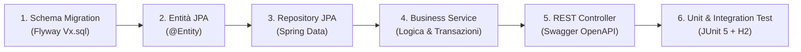

# Guida allo Sviluppo e Contribuzione

Guida operativa per sviluppatori e manutentori di **SpendyApp**, contenente le istruzioni per configurare l'ambiente locale, le convenzioni di codice, le procedure di build e test e il flusso standard per introdurre nuove funzionalità.

---

## 1. Prerequisiti dell'Ambiente di Sviluppo

Per sviluppare ed eseguire i microservizi di SpendyApp in locale sono necessari i seguenti strumenti:

| Strumento | Versione Minima Richiesta | Comando di Verifica | Scopo |
| :--- | :--- | :--- | :--- |
| **Java Development Kit (JDK)** | **Java 21 LTS** (Eclipse Temurin o OpenJDK) | `java -version` | Compilazione con Project Loom (Virtual Threads) |
| **Apache Maven** | **3.9.x** o superiore | `mvn -version` | Gestione build e dipendenze multi-modulo |
| **MySQL Server** | **8.0** o **8.4 LTS** | `mysql --version` | Database relazionale locale (oppure via Docker) |
| **Docker & Docker Compose** | Versione recente compatibile con Compose V2 | `docker compose version` | Containerizzazione e database di supporto |
| **OpenSSL** | 1.1.1 o 3.x | `openssl version` | Generazione facoltativa chiavi RSA in locale |

---

## 2. Struttura del Repository

```text
SpendyApp/
├── .env.example                                      # Modello delle variabili d'ambiente
├── .gitignore                                        # File e pattern esclusi da git
├── Dockerfile                                        # Build multi-stage OCI (auth, expense, gateway, all-in-one)
├── LICENSE                                           # Licenza GNU AGPLv3
├── README.md                                         # Documentazione generale di progetto
├── THIRD-PARTY-ALL.txt                               # Riconoscimento licenze dipendenze di terze parti
├── docker-compose.yml                                # Orchestrazione completa locale con MySQL 8.4
├── entrypoint.sh                                     # Script di avvio All-in-One con readiness polling
├── init-db.sql                                       # Script DDL per creazione database spendy_auth e spendy_expense
├── keys/                                             # Directory per chiavi RSA generate per ambiente dev
├── pom.xml                                           # POM Maven padre per dependency management
├── .github/
│   └── workflows/
│       └── continuous_integration_ and _deployment.yml # Pipeline CI/CD GitHub Actions
├── AuthMicroService/                                 # Microservizio di Autenticazione e Identity
│   ├── pom.xml
│   └── src/
│       ├── main/java/com/spendy/auth/
│       │   ├── Config/                               # Cors, SecurityConfig, OpenApiConfig
│       │   ├── Controller/                           # AuthController (JAX-RS + Spring MVC)
│       │   ├── DTO/                                  # Oggetti di trasporto richiesta/risposta
│       │   ├── Data/                                 # Entità JPA (User, RefreshToken)
│       │   ├── Repository/                           # Spring Data JPA (IUserRepository, IRefreshTokenRepository)
│       │   ├── Security/                             # JwtTokenService, RateLimitingFilter, JwtAuthenticationFilter
│       │   └── Service/                              # AuthService
│       └── main/resources/
│           ├── application.properties
│           └── db/migration/                         # Script Flyway V1, V2, V3
├── ExpenseMicroService/                              # Microservizio Gestione Spese ed AI
│   ├── pom.xml
│   └── src/
│       ├── main/java/com/spendyteam/expense/
│       │   ├── Config/                               # Cors, SecurityConfig, OpenApiConfig, WebClientConfig
│       │   ├── Controller/                           # ExpenseController
│       │   ├── DTO/                                  # DateFilterRequest, ExpenseCreateRequest, ecc.
│       │   ├── Data/                                 # Entità JPA (Expense)
│       │   ├── Repository/                           # IExpenseRepository
│       │   ├── Security/                             # JwtAuthenticationFilter
│       │   ├── Service/                              # ExpenseService, ExpenseCsvParser, ExpenseBatchWriter, ...
│       │   ├── Training/                             # ExpenseModelTrainer, dataset.txt
│       │   └── Utility/                              # ExpenseClassifier, ExpenseDataParser, ecc.
│       └── main/resources/
│           ├── application.properties
│           ├── expense-model.bin                     # Modello binario addestrato OpenNLP
│           └── db/migration/                         # Script Flyway V1
└── Gateway/                                          # API Gateway Reattivo
    ├── pom.xml
    └── src/
        ├── main/java/com/spendy/gateway/
        │   ├── Config/                               # OpenApiConfig
        │   ├── JWT/                                  # SecurityConfig (Reactive WebFlux OAuth2)
        │   └── GatewayApplication.java               # Classe principale di avvio e endpoint "/"
        └── main/resources/
            └── application.properties                # Regole di routing, path rewriting e CORS
```

---

## 3. Configurazione dell'Ambiente Locale

### 3.1. Predisposizione del Database MySQL
Se si dispone di MySQL locale o si intende avviarlo tramite Docker:
```bash
# Avviare solo il container MySQL tramite Docker Compose:
docker compose up -d mysql

# Verificare che il container sia in stato healthy:
docker compose ps mysql
```
In alternativa, per un server MySQL nativo:
```bash
mysql -u root -p < init-db.sql
```

### 3.2. Configurazione del File `.env`
Copiare il file template [.env.example](file:///Users/gius03/Progetti/SpendyProject/SpendyApp/.env.example) in `.env`:
```bash
cp .env.example .env
```
In ambiente di sviluppo locale, è sufficiente mantenere:
```env
MYSQL_HOST=localhost
MYSQL_PORT=3306
MYSQL_USER=spendy
MYSQL_PASSWORD=spendy_user_secret_change_in_prod
MYSQL_DATABASE_AUTH=spendy_auth
MYSQL_DATABASE_EXPENSE=spendy_expense
JWT_ALLOW_EPHEMERAL_KEYS=true
RATE_LIMITING_ENABLED=true
```

---

## 4. Procedure di Build e Avvio

### 4.1. Compilazione Completa con Maven
Per compilare l'intero progetto multi-modulo e generare i file di licenza:
```bash
mvn clean install -DskipTests
```

### 4.2. Esecuzione dei Test
Per eseguire la suite completa di 170 unit test e integration test con misurazione della copertura **JaCoCo**:
```bash
mvn test
```
I report HTML JaCoCo vengono generati nei percorsi:
- `AuthMicroService/target/site/jacoco/index.html`
- `ExpenseMicroService/target/site/jacoco/index.html`
- `Gateway/target/site/jacoco/index.html`

### 4.3. Avvio Indipendente dei Microservizi (Terminale Multiplo)
In tre finestre di terminale separate:

```bash
# Finestra 1: Auth Microservice (Porta 8081)
cd AuthMicroService
mvn spring-boot:run

# Finestra 2: Expense Microservice (Porta 8084)
cd ExpenseMicroService
mvn spring-boot:run

# Finestra 3: API Gateway (Porta 7860)
cd Gateway
mvn spring-boot:run
```

---

## 5. Come Introdurre una Nuova Funzionalità (Workflow Standard)

Quando si implementa una nuova funzionalità o si estende il dominio dell'applicazione, seguire rigorosamente questi passaggi:



1. **Modifica dello Schema Database**:
   - Creare un nuovo script di migrazione Flyway incrementale in `db/migration/` (es. `V2__nome_migrazione.sql`).
   - Non modificare mai a ritroso migrazioni già rilasciate.
2. **Aggiornamento o Creazione dell'Entità JPA**:
   - Mappare le nuove colonne nell'entità corrispondente (es. [Expense.java](file:///Users/gius03/Progetti/SpendyProject/SpendyApp/ExpenseMicroService/src/main/java/com/spendyteam/expense/Data/Expense.java)).
   - Aggiungere le opportune annotazioni Swagger `@Schema` e i vincoli JPA.
3. **Estensione del Repository**:
   - Dichiarare i metodi di query in [IExpenseRepository.java](file:///Users/gius03/Progetti/SpendyProject/SpendyApp/ExpenseMicroService/src/main/java/com/spendyteam/expense/Repository/IExpenseRepository.java) o [IUserRepository.java](file:///Users/gius03/Progetti/SpendyProject/SpendyApp/AuthMicroService/src/main/java/com/spendy/auth/Repository/IUserRepository.java).
4. **Logica di Business nel Service**:
   - Implementare il metodo nel rispettivo Service annotandolo con `@Transactional` (o `@Transactional(readOnly = true)` per le operazioni di sola lettura).
5. **Esposizione nel Controller**:
   - Aggiungere l'endpoint nel Controller ([ExpenseController.java](file:///Users/gius03/Progetti/SpendyProject/SpendyApp/ExpenseMicroService/src/main/java/com/spendyteam/expense/Controller/ExpenseController.java) o [AuthController.java](file:///Users/gius03/Progetti/SpendyProject/SpendyApp/AuthMicroService/src/main/java/com/spendy/auth/Controller/AuthController.java)).
   - Annotare l'operazione con `@Operation`, `@ApiResponses`, `@RequestBody` e `@SecurityRequirement(name = "bearerAuth")`.
6. **Scrittura dei Test Automatici**:
   - Aggiungere il test unitario o di integrazione in `src/test/java/`. I test di persistenza utilizzano il profilo H2 in-memory configurato in [application-test.properties](file:///Users/gius03/Progetti/SpendyProject/SpendyApp/Gateway/src/test/resources/application-test.properties) senza richiedere MySQL locale.

---

## 6. Convenzioni di Codice e Git

### 6.1. Convenzioni Git e Commit Messages
Il repository adotta lo standard **Conventional Commits**:
- `feat: <descrizione>`: Nuove funzionalità applicative.
- `fix: <descrizione>`: Correzione di anomalie o vulnerabilità di sicurezza.
- `refactor: <descrizione>`: Ristrutturazione del codice senza alterazione del comportamento esterno.
- `chore: <descrizione>`: Pulizia file di build, aggiornamento dipendenze o configurazioni IDE.
- `test: <descrizione>`: Aggiunta o estensione di test automatici.

### 6.2. Regole di Qualità del Codice
- **Virtual Threads**: Non utilizzare pool di thread `Executors.newFixedThreadPool()` per compiti I/O-bound: utilizzare sempre i Virtual Threads di Java 21 (`Executors.newVirtualThreadPerTaskExecutor()`).
- **Nessuna Esposizione di Segreti**: Non effettuare mai il commit di file `.env`, file con estensione `.pem`, `.key` o credenziali in chiaro. La directory `keys/` e il file `.env` sono rigorosamente inclusi in [.gitignore](file:///Users/gius03/Progetti/SpendyProject/SpendyApp/.gitignore).
- **Trattamento Eccezioni**: Non inghiottire le eccezioni con blocchi `catch` vuoti; registrare sempre l'errore tramite SLF4J `log.error(...)` o `log.warn(...)`.
