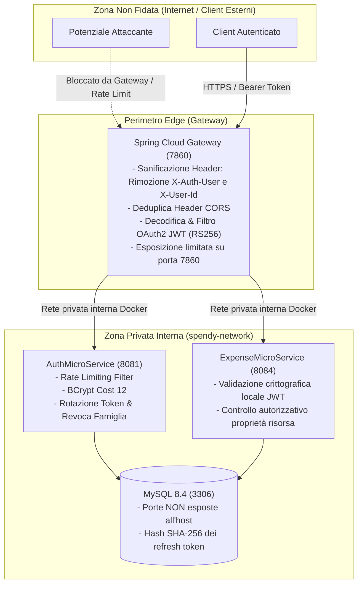

# Analisi della Sicurezza e Threat Model

Valutazione tecnica dei confini di fiducia, delle superfici di attacco, dei meccanismi crittografici, della gestione dei segreti e delle mitigazioni implementate in **SpendyApp**.

---

## 1. Confini di Fiducia e Superficie di Attacco

Il perimetro di sicurezza di SpendyApp è organizzato a livelli concentrici (Defense-in-Depth):



### 1.1. Protezione Perimetrale e Sanificazione degli Header
All'ingresso del Gateway ([Gateway/application.properties](../Gateway/src/main/resources/application.properties#L18-L22)):
1. **Rimozione Preventiva di Header di Spoofing**:
   ```properties
   spring.cloud.gateway.default-filters[1]=RemoveRequestHeader=X-Auth-User
   spring.cloud.gateway.default-filters[2]=RemoveRequestHeader=X-User-Id
   ```
   I filtri eliminano qualsiasi header di identità potenzialmente iniettato da un client esterno per tentare di impersonare un altro utente.
2. **Deduplica CORS**:
   Viene applicato `DedupeResponseHeader=Access-Control-Allow-Origin Access-Control-Allow-Credentials, RETAIN_FIRST` per scongiurare errori di parsing nei browser dovuti a header CORS duplicati inviati dai servizi interni.
3. **Isolamento di Rete Docker**:
   Nel file [docker-compose.yml](../docker-compose.yml#L8-L9), la porta MySQL `3306` e le porte interne `8081` e `8084` sono vincolate alla rete bridge privata `spendy-network` tramite la direttiva `expose`, impedendo qualsiasi connessione diretta dall'esterno.

---

## 2. Protezione dei Dati Sensibili e Crittografia

### 2.1. Conservazione delle Password Utente
- **Algoritmo**: BCrypt con fattore di costo 12 (`2^12 = 4096` iterazioni).
- **Salt**: Generato automaticamente in modo univoco per ogni record da `BCryptPasswordEncoder`.
- **Visibilità nel codice**: Il campo `password` dell'entità [User.java](../AuthMicroService/src/main/java/com/spendy/auth/Data/User.java#L30) è annotato con `accessMode = Schema.AccessMode.WRITE_ONLY` per impedire che l'hash venga accidentalmente serializzato nelle risposte JSON.

### 2.2. Mitigazione Timing Attack per Enumerazione Utenti
Durante il login in [AuthService.java](../AuthMicroService/src/main/java/com/spendy/auth/Service/AuthService.java#L63-L76):
- Se un utente non esiste, il sistema non ritorna immediatamente un errore (cosa che rivelerebbe che lo username è inesistente), ma esegue un confronto BCrypt fittizio con un hash precalcolato (`DUMMY_BCRYPT_HASH`).
- In questo modo il tempo computazionale di risposta è identico sia in caso di password errata per utente valido, sia per utente inesistente, impedendo l'enumerazione degli account tramite analisi temporale.

### 2.3. Hashing dei Refresh Token con SHA-256
A partire dalla migrazione `V3` ([V3__security_refresh_tokens_null_token.sql](../AuthMicroService/src/main/resources/db/migration/V3__security_refresh_tokens_null_token.sql)):
- Il token in chiaro generato (32 byte crittografici) viene restituito **unicamente al client** nella risposta HTTP.
- Nel database relazionale viene salvato **soltanto il digest SHA-256** (`token_hash`), mentre la colonna `token` è mantenuta `NULL`.
- In caso di violazione o data-leak del database `spendy_auth`, un attaccante non ottiene token di sessione utilizzabili.

---

## 3. Gestione e Firma dei Token JWT (RS256)

### 3.1. Crittografia Asimmetrica
- **Firma**: Eseguita esclusivamente da `AuthMicroService` mediante chiave privata RSA-2048 ([JwtTokenService.java](../AuthMicroService/src/main/java/com/spendy/auth/Security/JwtTokenService.java#L231-L233)).
- **Verifica**: Gateway ed Expense Microservice convalidano i token localmente utilizzando la chiave pubblica RSA senza condividere alcun segreto simmetrico.
- **Validazione Rigorosa degli Algoritmi**: Tutti i parser rigettano categoricamente token con algoritmo `none`, algoritmi simmetrici `HS256` o qualsiasi algoritmo diverso da `RS256`.
- **Claims Obbligatori**: Vengono verificati `exp` (con tolleranza zero su token scaduti), `iss` (`"spendy-auth"`), `aud` (`"spendy-app"`) e `sub` (non nullo e non vuoto).

### 3.2. Divieto delle Chiavi Effimere in Produzione
In [JwtTokenService.java](../AuthMicroService/src/main/java/com/spendy/auth/Security/JwtTokenService.java#L403-L411), [SecurityConfig.java (Gateway)](../Gateway/src/main/java/com/spendy/gateway/JWT/SecurityConfig.java#L211-L217) e [UserAuthService.java](../ExpenseMicroService/src/main/java/com/spendyteam/expense/Service/UserAuthService.java#L143-L150):
- Se l'ambiente corrisponde alla produzione e `jwt.allow-ephemeral-keys=true` (oppure mancano le chiavi RSA configurate), l'applicazione va in crash controllato con `IllegalStateException`:
  ```text
  CRITICAL SECURITY ERROR: Ephemeral keys are strictly forbidden in production mode.
  Configure valid RSA keys (jwt.private-key or jwt.private-key-location) and set jwt.allow-ephemeral-keys=false.
  ```

---

## 4. Validazione degli Input e Protezione Iniezioni

1. **Email e Username**:
   - Validazione formale con espressione regolare compilata staticamente (`EMAIL_PATTERN` e `USERNAME_PATTERN`).
   - Lunghezza controllata: username tra 3 e 50 caratteri, password tra 8 e 128 caratteri.
2. **Protezione SQL Injection**:
   - Tutte le interazioni con il database avvengono tramite Spring Data JPA con query parametrizzate (`@Param`).
   - Anche la query nativa di aggregazione mensile [IExpenseRepository.aggregateMonthlyExpenses](../ExpenseMicroService/src/main/java/com/spendyteam/expense/Repository/IExpenseRepository.java#L60-L76) impiega parametri vincolati `:username`, `:start` ed `:end`.
3. **Validazione File CSV**:
   - Verifica delle dimensioni massime (`spring.servlet.multipart.max-file-size=10MB`).
   - Rilevamento automatico e isolamento dei delimitatori.
   - Cattura degli errori di riga durante il parsing senza interruzione dell'intero file, con conteggio trasparente dei fallimenti.

---

## 5. Controllo di Accesso alle Risorse (IDOR Prevention)

In [ExpenseService.java](../ExpenseMicroService/src/main/java/com/spendyteam/expense/Service/ExpenseService.java#L268-L272) e [updateExpense](../ExpenseMicroService/src/main/java/com/spendyteam/expense/Service/ExpenseService.java#L343-L345):
- Quando un utente richiede l'aggiornamento o l'eliminazione di una spesa specificando un `expenseId`, il sistema carica l'entità dal database e controlla esplicitamente:
  ```java
  if (!username.equals(expense.getUsername())) {
      return Response.status(Response.Status.FORBIDDEN)
                     .entity("You are not authorized to delete this expense.")
                     .build();
  }
  ```
- Questo controllo previene attacchi di tipo **Insecure Direct Object Reference (IDOR)**: un utente autenticato non può manipolare o cancellare le transazioni di altri account pur conoscendone l'identificativo UUID.

---

## 6. Configurazione CORS Globale

In [CorsGlobalConfiguration.java](../AuthMicroService/src/main/java/com/spendy/auth/Config/CorsGlobalConfiguration.java) e nel Gateway:
- **Origini Consentite**: Lista esplicita (`CORS_ALLOWED_ORIGINS`). Nessun wildcard `*` è consentito quando `allowCredentials` è impostato a `true`.
- **Header Esposti**: Solo `Authorization`.
- **Header Autorizzati**: `Authorization`, `Content-Type`, `Accept`, `Origin`, `X-Requested-With`.
- **Max Age**: `3600` secondi per ridurre le richieste pre-flight OPTIONS non necessarie.

---

## 7. Rischi Identificati e Raccomandazioni Prioritarie

| Rischio / Area di Attenzione | Livello di Rischio | Mitigazione Corrente | Raccomandazione Prioritaria |
| :--- | :--- | :--- | :--- |
| **Rate Limiting In-Memory in caso di Scalabilità Orizzontale** | **Medio** | I contatori sono mantenuti in `ConcurrentHashMap` con pulizia automatica per singola istanza. | Se il Gateway viene scalato su più nodi, integrare uno storage di rate-limiting distribuito basato su **Redis** o Token Bucket condiviso. |
| **Iniezione Segreti tramite Variabili d'Ambiente** | **Basso-Medio** | Le chiavi PEM e le password DB sono iniettate tramite `.env` o variabili d'ambiente OS. | Per cluster enterprise o Kubernetes, montare i segreti tramite **HashiCorp Vault** o Secret Provider Driver CSI (Kubernetes Secrets). |
| **Traffico HTTP non cifrato tra Gateway e Servizi Interni** | **Basso** | I container comunicano in chiaro HTTP su una rete bridge privata Docker interna non esposta all'host. | In caso di distribuzione multi-nodo (es. nodi Kubernetes distinti), abilitare **mTLS** (Mutual TLS) tra i pod o utilizzare una Service Mesh (es. Istio / Linkerd). |
| **Revoca Immediata di Access Token ancora Validi** | **Basso** | Gli access token durano 15 minuti e sono stateless. La revoca immediata si applica al Refresh Token. | In caso di necessità di blocco istantaneo di un account compromesso prima dello scadere dei 15 minuti, implementare una token blacklist distribuita in memoria (es. Redis). |
