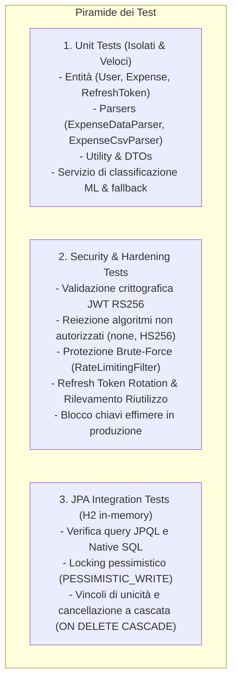

# Strategia di Test e Assicurazione della Qualità

Documentazione tecnica della strategia di testing, dei framework utilizzati, dei livelli di verifica e dei risultati di copertura del codice (**JaCoCo**) in **SpendyApp**.

---

## 1. Strategia e Livelli di Test

La suite di test di SpendyApp garantisce la correttezza logica, l'integrità dei dati e la robustezza crittografica attraverso tre livelli distinti:



---

## 2. Framework e Strumenti Utilizzati

| Framework / Libreria | Versione | Ambito di Utilizzo |
| :--- | :--- | :--- |
| **JUnit 5 (Jupiter)** | 5.11.x (Spring Boot 3.5 BOM) | Esecuzione dei test unitari e di integrazione |
| **Mockito & Mockito Inline** | 5.2.0 | Creazione di mock per repository, servizi Web e token |
| **Spring Boot Starter Test** | 3.5.0 | Contesto di test Spring, iniezione delle dipendenze per slice test |
| **Spring Security Test** | 6.x | Simulazione di contesti di sicurezza `SecurityContext` e token Bearer |
| **Reactor Test** | 3.6.x | Test reattivi non bloccanti per le route e la sicurezza del Gateway WebFlux |
| **H2 Database** | 2.3.x | Motore di database in memoria con compatibilità MySQL (`MODE=MySQL`) |
| **JaCoCo Maven Plugin** | 0.8.12 | Generazione dei report di copertura e verifica delle metriche di istruzione |

---

## 3. Risultati della Suite di Test e Metriche di Copertura

La suite di test automatizzata conta **170 test totali**, tutti superati con successo senza alcun fallimento o skip:

```text
[INFO] Reactor Summary for spendy 0.0.1-SNAPSHOT:
[INFO] spendy ............................................. SUCCESS [ 0.447 s]
[INFO] AuthMicroService ................................... SUCCESS [10.243 s]
[INFO] Gateway ............................................ SUCCESS [ 4.473 s]
[INFO] ExpenseMicroService ................................ SUCCESS [ 6.944 s]
[INFO] ------------------------------------------------------------------------
[INFO] BUILD SUCCESS
[INFO] Tests run: 170, Failures: 0, Errors: 0, Skipped: 0
```

### Copertura del Codice JaCoCo (Istruzioni Eseguite):
I dati estratti dai report [jacoco.csv](file:///Users/gius03/Progetti/SpendyProject/SpendyApp/ExpenseMicroService/target/site/jacoco/jacoco.csv) evidenziano i seguenti livelli di copertura:

| Modulo | Istruzioni Coperte | Istruzioni Totali | Percentuale di Copertura | Test Totali |
| :--- | :--- | :--- | :--- | :--- |
| **Gateway** | 539 | 733 | **73.53%** | 3 test class ([GatewaySecurityTest](file:///Users/gius03/Progetti/SpendyProject/SpendyApp/Gateway/src/test/java/com/spendy/gateway/JWT/GatewaySecurityTest.java), [SecurityConfigTest](file:///Users/gius03/Progetti/SpendyProject/SpendyApp/Gateway/src/test/java/com/spendy/gateway/JWT/SecurityConfigTest.java), [GatewayApplicationTest](file:///Users/gius03/Progetti/SpendyProject/SpendyApp/Gateway/src/test/java/com/spendy/gateway/GatewayApplicationTest.java)) |
| **AuthMicroService** | 2.429 | 3.693 | **65.77%** | 13 test class |
| **ExpenseMicroService** | 2.945 | 4.620 | **63.74%** | 17 test class |
| **Totale Piattaforma** | **5.913** | **9.046** | **65.37%** | **170 test unitari e di integrazione** |

---

## 4. Test di Sicurezza Specifici (Security Hardening Test Suite)

Il codebase include test mirati alla verifica puntuale delle difese di sicurezza:

1. **[JwtSecurityHardeningTest.java](file:///Users/gius03/Progetti/SpendyProject/SpendyApp/AuthMicroService/src/test/java/com/spendy/auth/Security/JwtSecurityHardeningTest.java)**:
   - Rifiuto categorico di token con algoritmo `none`.
   - Rifiuto di token con firma manomessa o calcolata con algoritmo simmetrico HS256 non autorizzato.
   - Rigetto immediato di token con claim obbligatori mancanti (`exp`, `iss`, `aud`, `sub`).
   - Rifiuto di token scaduti anche per 1 solo secondo.
2. **[RateLimitingFilterSecurityTest.java](file:///Users/gius03/Progetti/SpendyProject/SpendyApp/AuthMicroService/src/test/java/com/spendy/auth/Security/RateLimitingFilterSecurityTest.java)**:
   - Verifica del blocco al raggiungimento dell'11° tentativo di login nello stesso minuto.
   - Calcolo accurato dell'header HTTP `Retry-After`.
   - Rifiuto dello spoofing dell'header `X-Forwarded-For` da nodi non riconosciuti come proxy fidati.
3. **[SessionSecurityHardeningTest.java](file:///Users/gius03/Progetti/SpendyProject/SpendyApp/AuthMicroService/src/test/java/com/spendy/auth/Security/SessionSecurityHardeningTest.java)**:
   - Verifica della Refresh Token Rotation: emissione di un nuovo token e contestuale revoca del precedente.
   - Rilevamento del riutilizzo di token revocati e conseguente revoca a catena di tutti i token con lo stesso `family_id`.
   - Conferma che nel database viene salvato unicamente l'hash SHA-256 e che la colonna `token` è `NULL`.
4. **[DeploymentSecurityHardeningTest.java](file:///Users/gius03/Progetti/SpendyProject/SpendyApp/AuthMicroService/src/test/java/com/spendy/auth/Security/DeploymentSecurityHardeningTest.java)**:
   - Verifica che l'avvio in modalità produzione fallisca con eccezione se `jwt.allow-ephemeral-keys=true` o se mancano le chiavi RSA.

---

## 5. Esecuzione dei Test e Debugging

### 5.1. Esecuzione Globale
```bash
mvn test
```

### 5.2. Esecuzione per Singolo Modulo
```bash
mvn test -pl AuthMicroService
mvn test -pl ExpenseMicroService
mvn test -pl Gateway
```

### 5.3. Esecuzione di una Singola Classe o Metodo di Test
```bash
# Esecuzione di una specifica classe di test:
mvn test -Dtest=JwtSecurityHardeningTest

# Esecuzione di un singolo metodo di test:
mvn test -Dtest=SessionSecurityHardeningTest#testRefreshTokenReuseRevokesFamily
```

---

## 6. Aree Non Coperte e Debito Tecnico dei Test

Sebbene la suite unitaria e di integrazione sia solida (170 test), l'analisi del repository evidenzia le seguenti aree scoperte:
1. **Test End-to-End su MySQL Reale**:
   I test di integrazione JPA correnti ([AuthJpaPersistenceIntegrationTest](file:///Users/gius03/Progetti/SpendyProject/SpendyApp/AuthMicroService/src/test/java/com/spendy/auth/Repository/AuthJpaPersistenceIntegrationTest.java) e [ExpenseJpaPersistenceIntegrationTest](file:///Users/gius03/Progetti/SpendyProject/SpendyApp/ExpenseMicroService/src/test/java/com/spendyteam/expense/Repository/ExpenseJpaPersistenceIntegrationTest.java)) si appoggiano su un database in-memory H2 configurato con alias SQL ([H2FunctionAliases.java](file:///Users/gius03/Progetti/SpendyProject/SpendyApp/ExpenseMicroService/src/test/java/com/spendyteam/expense/Utility/H2FunctionAliases.java)). Sarebbe opportuno integrare **Testcontainers** per validare le query native direttamente su un container MySQL 8.4 ufficiale.
2. **Test di Carico e Stress Concurrent**:
   I precedenti test di performance sono stati dismessi (commit `1eeb583` e `3526a5c`). È raccomandata l'adozione di strumenti come k6 o Gatling per validare la tenuta del semaforo di persistenza (`ExpenseBatchWriter`) e del pool HikariCP sotto carichi elevati di importazione CSV.
3. **Integrazione tra Gateway e Microservizi in Rete Reale**:
   Attualmente i test del Gateway testano la catena reattiva e la decodifica JWT, ma non eseguono chiamate HTTP reali verso le istanze in ascolto dei microservizi a valle.
